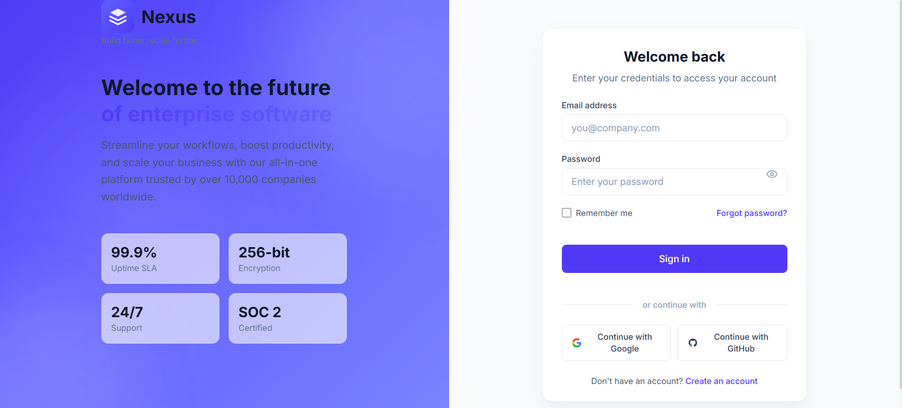
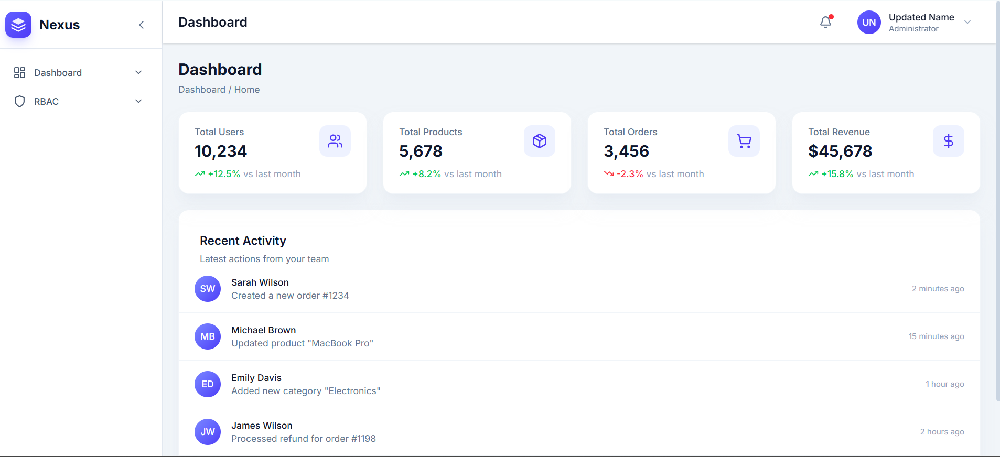
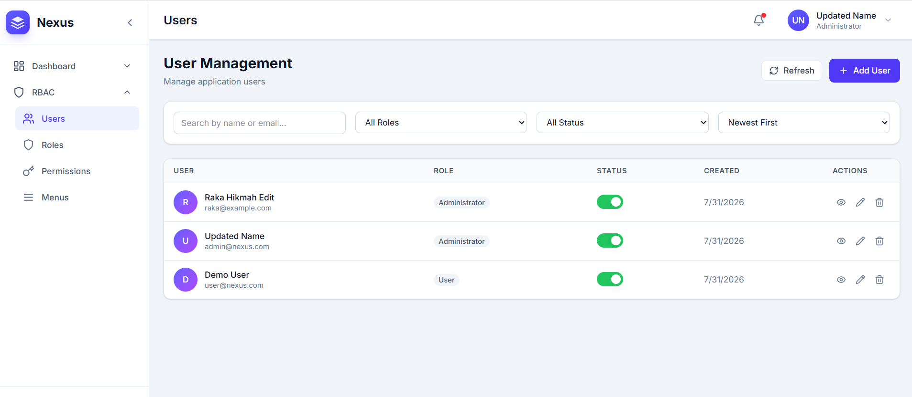
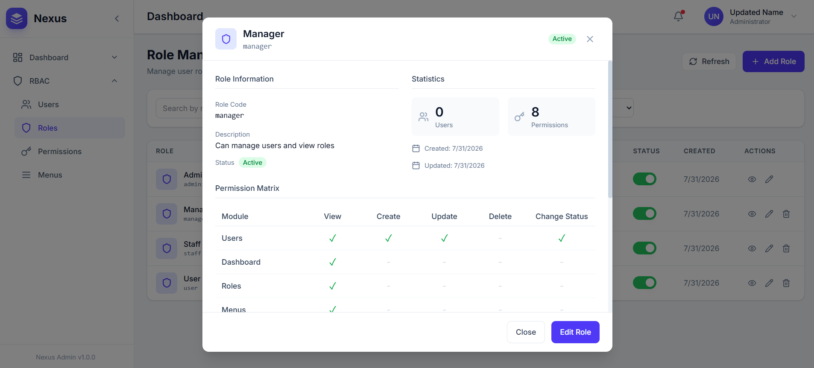
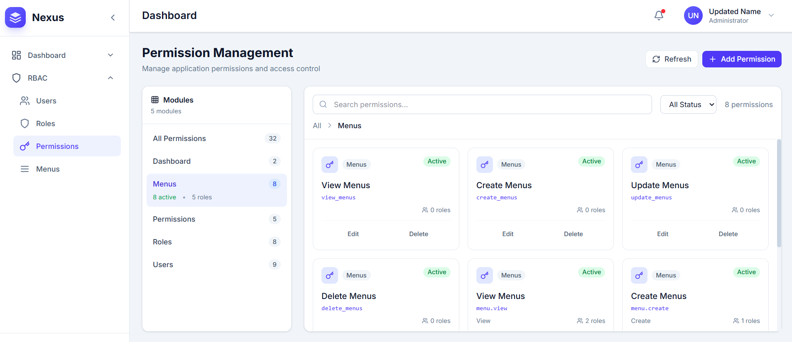
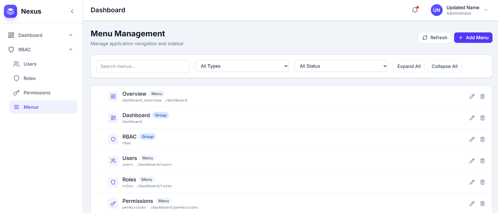
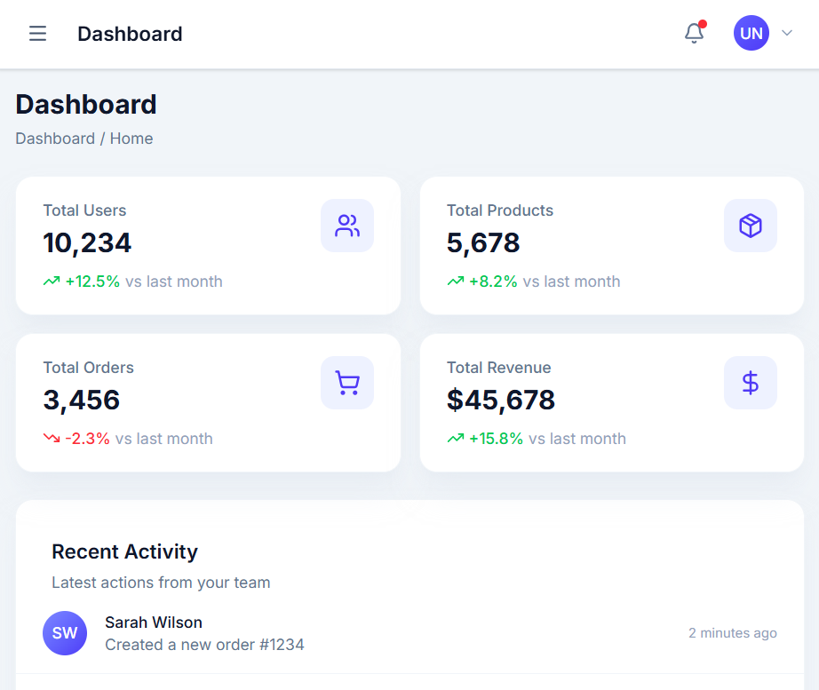

# TRX ERP Lite

> A powerful, production-ready admin panel starter kit with Role-Based Access Control (RBAC), security features, and modern tech stack.


## 📖 Overview

TRX ERP Lite is an open-source admin panel starter kit designed to jumpstart your next project. It provides a solid foundation with essential modules like authentication, RBAC, user management, role management, and a responsive admin dashboard — all built with modern technologies and best practices.

**Use it however you want.** Customize it, extend it, or strip it down to fit your needs. This is YOUR project now.

---

## 📸 Screenshots

### Login Page


### Dashboard


### User Management


### Role Management


### Permission Management


### Menu Management


### Mobile Responsive View



## 🚀 Features

### Core Modules

| Module | Description |
|--------|-------------|
| **Authentication** | Secure JWT-based login system with token refresh mechanism |
| **User Management** | Full CRUD operations for user accounts with role assignment |
| **Role Management** | Create and manage roles with granular permission sets |
| **Permission Management** | Explorer-style interface for managing permission codes |
| **Menu Management** | Hierarchical tree-based menu configuration |
| **RBAC** | Full Role-Based Access Control implementation |
| **Dashboard** | Modern, responsive admin dashboard |

### Security Features

- **JWT Authentication** with access and refresh tokens
- **Password Hashing** using industry-standard algorithms
- **Role-Based Guards** for API endpoint protection
- **Permission Checks** at both frontend and backend levels
- **CORS Configuration** for cross-origin request control
- **Input Validation** using Zod schemas

### UI/UX

- **Modern Design** with Tailwind CSS v4
- **Smooth Animations** powered by Framer Motion
- **Responsive Layout** works on desktop and mobile
- **Lucide Icons** for consistent iconography
- **Toast Notifications** for user feedback

---

## 🛠 Technology Stack

### Frontend

| Technology | Version | Purpose |
|------------|---------|---------|
| **React** | 19 | UI library |
| **TypeScript** | 5.x | Type safety |
| **Vite** | 6.x | Build tool & dev server |
| **Tailwind CSS** | v4 | Styling |
| **React Router** | v7 | Client-side routing |
| **Redux Toolkit** | 2.x | State management |
| **TanStack Query** | v5 | Server state management |
| **React Hook Form** | 7.x | Form handling |
| **Zod** | 3.x | Schema validation |
| **Framer Motion** | 11.x | Animations |
| **Lucide React** | latest | Icons |

### Backend

| Technology | Version | Purpose |
|------------|---------|---------|
| **NestJS** | 11 | Backend framework |
| **TypeScript** | 5.x | Type safety |
| **TypeORM** | latest | Database ORM |
| **MySQL** | 8.3 | Database |
| **Passport JWT** | latest | Authentication |
| **Class Validator** | latest | DTO validation |

---

## 📁 Project Structure

```
trx-erp-lite/
├── backend/                        # NestJS REST API
│   ├── src/
│   │   ├── main.ts                 # Application entry point
│   │   ├── app.module.ts           # Root module
│   │   ├── config/                 # Configuration files
│   │   │   ├── app.config.ts       # App settings (port, CORS)
│   │   │   ├── database.config.ts  # MySQL connection
│   │   │   └── jwt.config.ts       # JWT settings
│   │   ├── common/                 # Shared utilities
│   │   │   ├── guards/             # Auth guards
│   │   │   ├── decorators/        # Custom decorators
│   │   │   ├── filters/           # Exception filters
│   │   │   └── interceptors/      # Response interceptors
│   │   └── modules/                # Feature modules
│   │       ├── auth/              # Authentication module
│   │       ├── users/             # User management
│   │       ├── roles/             # Role management
│   │       ├── permissions/       # Permission management
│   │       └── menus/             # Menu management
│   ├── package.json
│   └── tsconfig.json
│
├── frontend/                       # React SPA
│   ├── src/
│   │   ├── main.tsx                # Entry point
│   │   ├── App.tsx                 # Root component
│   │   ├── api/                    # API client functions
│   │   ├── components/
│   │   │   ├── ui/                # Reusable UI components
│   │   │   │   ├── Button.tsx
│   │   │   │   ├── Input.tsx
│   │   │   │   ├── Card.tsx
│   │   │   │   ├── Modal.tsx
│   │   │   │   ├── Toast.tsx
│   │   │   │   └── ...
│   │   │   ├── layout/            # Layout components
│   │   │   │   ├── DashboardLayout.tsx
│   │   │   │   ├── Sidebar.tsx
│   │   │   │   └── Header.tsx
│   │   │   ├── auth/              # Auth components
│   │   │   │   └── LoginForm.tsx
│   │   │   └── master/            # Master components
│   │   │       ├── MasterPage.tsx
│   │   │       └── MasterTable.tsx
│   │   ├── pages/                 # Page components
│   │   │   ├── Login/
│   │   │   ├── Dashboard/
│   │   │   ├── Users/
│   │   │   ├── Roles/
│   │   │   ├── Permissions/
│   │   │   └── Menus/
│   │   ├── hooks/                 # Custom React hooks
│   │   │   └── useHasPermission.ts # Permission check hook
│   │   ├── routes/                # Routing configuration
│   │   ├── store/                 # Redux store & slices
│   │   ├── types/                 # TypeScript type definitions
│   │   ├── utils/                 # Utility functions
│   │   └── constants/             # App constants & tokens
│   ├── package.json
│   └── vite.config.ts
│
└── dump-trx-erp_lite-*.sql        # Database schema
```

---

## 🔐 Permission System

### Permission Code Format

Permissions follow the pattern: `{resource}.{action}`

| Resource | Actions | Permission Codes |
|----------|---------|------------------|
| Dashboard | view | `dashboard.view` |
| Users | view, create, update, delete, change_status | `user.view`, `user.create`, `user.update`, `user.delete`, `user.change_status` |
| Roles | view, create, update, delete | `role.view`, `role.create`, `role.update`, `role.delete` |
| Permissions | view | `permission.view` |
| Menus | view, create, update, delete | `menu.view`, `menu.create`, `menu.update`, `menu.delete` |

### How RBAC Works

```
Users ←→ User Roles ←→ Roles ←→ Role Permissions ←→ Permissions
```

1. **Users** are assigned **Roles**
2. **Roles** have **Permissions**
3. **Permissions** grant access to specific resources and actions
4. Both **frontend** (UI components) and **backend** (API endpoints) enforce permissions

---

## 📋 Database Schema

### Tables

| Table | Description |
|-------|-------------|
| `users` | User accounts with hashed passwords |
| `roles` | Role definitions |
| `permissions` | Permission codes (e.g., `user.create`) |
| `menus` | Hierarchical menu items (GROUP, MENU, SUBMENU, LINK) |
| `user_roles` | Many-to-many user-role relationship |
| `role_permissions` | Many-to-many role-permission relationship |
| `menu_permissions` | Many-to-many menu-permission relationship |

---

## ⚙️ Installation & Setup

### Prerequisites

- **Node.js** >= 18.0.0
- **MySQL** 8.3 or higher
- **npm** or **yarn**

### Step 1: Clone the Repository

```bash
git clone <repository-url>
cd trx-erp-lite
```

### Step 2: Setup Database

1. Create a new MySQL database:

```sql
CREATE DATABASE erp_lite CHARACTER SET utf8mb4 COLLATE utf8mb4_unicode_ci;
```

2. Import the database schema from the SQL dump file:

```bash
mysql -u root -p erp_lite < dump-trx-erp_lite-*.sql
```

### Step 3: Configure Backend

Navigate to the backend directory and configure environment:

```bash
cd backend
npm install
```

Create or update configuration files in `backend/src/config/`:

**`database.config.ts`** - Update MySQL connection:
```typescript
export default registerAs('database', () => ({
  type: 'mysql',
  host: process.env.DB_HOST || 'localhost',
  port: parseInt(process.env.DB_PORT || '3306', 10),
  username: process.env.DB_USERNAME || 'root',
  password: process.env.DB_PASSWORD || 'your_password',
  database: process.env.DB_DATABASE || 'erp_lite',
  // ... rest of config
}));
```

**`jwt.config.ts`** - Update JWT secret (IMPORTANT: Use a strong, unique secret in production):
```typescript
export default registerAs('jwt', () => ({
  secret: process.env.JWT_SECRET || 'your-super-secret-key-change-in-production',
  expiresIn: process.env.JWT_EXPIRES_IN || '1d',
  refreshExpiresIn: process.env.JWT_REFRESH_EXPIRES_IN || '7d',
}));
```

**`app.config.ts`** - Update CORS origins if needed:
```typescript
export default registerAs('app', () => ({
  port: parseInt(process.env.PORT || '3000', 10),
  corsOrigins: process.env.CORS_ORIGINS?.split(',') || ['http://localhost:5173'],
}));
```

### Step 4: Configure Frontend

Navigate to the frontend directory:

```bash
cd ../frontend
npm install
```

Update the environment file **`frontend/.env`**:
```env
VITE_API_BASE_URL=http://localhost:3000
```

### Step 5: Start Development Servers

**Terminal 1 - Backend:**
```bash
cd backend
npm run start:dev
```

**Terminal 2 - Frontend:**
```bash
cd frontend
npm run dev
```

### Step 6: Access the Application

Open your browser and navigate to:
- **Frontend**: http://localhost:5173
- **Backend API**: http://localhost:3000

### Default Admin Credentials

| Field | Value |
|-------|-------|
| **Email** | `admin@nexus.com` |
| **Password** | `admin123` |

> ⚠️ **Important:** Change the default admin password immediately after first login!

---

## 🔧 API Endpoints

### Authentication

| Method | Endpoint | Description |
|--------|----------|-------------|
| POST | `/auth/login` | User login |
| POST | `/auth/refresh` | Refresh access token |
| GET | `/auth/profile` | Get current user profile |

### Users

| Method | Endpoint | Description |
|--------|----------|-------------|
| GET | `/users` | List all users |
| GET | `/users/:id` | Get user by ID |
| POST | `/users` | Create new user |
| PATCH | `/users/:id` | Update user |
| DELETE | `/users/:id` | Delete user |
| PATCH | `/users/:id/status` | Toggle user status |

### Roles

| Method | Endpoint | Description |
|--------|----------|-------------|
| GET | `/roles` | List all roles |
| GET | `/roles/:id` | Get role by ID |
| POST | `/roles` | Create new role |
| PATCH | `/roles/:id` | Update role |
| DELETE | `/roles/:id` | Delete role |

### Permissions

| Method | Endpoint | Description |
|--------|----------|-------------|
| GET | `/permissions` | List all permissions |

### Menus

| Method | Endpoint | Description |
|--------|----------|-------------|
| GET | `/menus` | List all menus (tree structure) |
| GET | `/menus/:id` | Get menu by ID |
| POST | `/menus` | Create new menu |
| PATCH | `/menus/:id` | Update menu |
| DELETE | `/menus/:id` | Delete menu |

---

## 📁 Environment Variables

### Backend

| Variable | Default | Description |
|----------|---------|-------------|
| `PORT` | `3000` | Server port |
| `DB_HOST` | `localhost` | MySQL host |
| `DB_PORT` | `3306` | MySQL port |
| `DB_USERNAME` | `root` | MySQL username |
| `DB_PASSWORD` | - | MySQL password |
| `DB_DATABASE` | `erp_lite` | Database name |
| `JWT_SECRET` | - | JWT signing secret |
| `JWT_EXPIRES_IN` | `1d` | Access token expiry |
| `JWT_REFRESH_EXPIRES_IN` | `7d` | Refresh token expiry |
| `CORS_ORIGINS` | `http://localhost:5173` | Allowed CORS origins |

### Frontend

| Variable | Default | Description |
|----------|---------|-------------|
| `VITE_API_BASE_URL` | `http://localhost:3000` | Backend API URL |

---

## 🎨 Customization Guide

### Adding New Modules

1. **Backend**: Create a new NestJS module
   ```bash
   cd backend
   nest g resource modules/new-module
   ```

2. **Frontend**: Create new page and components
   ```bash
   cd frontend/src/pages
   mkdir NewModule
   ```

3. **Database**: Add new tables and run migrations

4. **Permissions**: Register new permission codes

### Modifying the Theme

Edit Tailwind configuration in `frontend/tailwind.config.js` to customize colors, fonts, and spacing.

### Adding New Permissions

1. Insert new permission codes into the `permissions` table
2. Update the permission service
3. Use the `@RequirePermissions()` decorator on new endpoints

---

## 📝 License

This project is open source and available under the **MIT License**.

You are free to:
- ✅ Use this project for personal or commercial purposes
- ✅ Modify and customize it to fit your needs
- ✅ Distribute it as part of your own projects
- ✅ Build upon it and create derivative works

Under the following terms:
- ✅ Include the original copyright notice
- ✅ Use the same license for derivative works

---

## 📧 Contact & Support

For questions, suggestions, bug reports, or just to say hi — feel free to reach out:

**Email:** raka.hikmahramdhan@gmail.com

---

## 👤 Author

**Raka Hikmah Ramadhan**

---

## 🙏 Acknowledgments

Built with love using:

<div align="center">


</div>

---

<div align="center">

**Made with ❤️ by Raka Hikmah Ramadhan**

**Copyright © 2026 Raka Hikmah Ramadhan. All rights reserved.**

</div>
