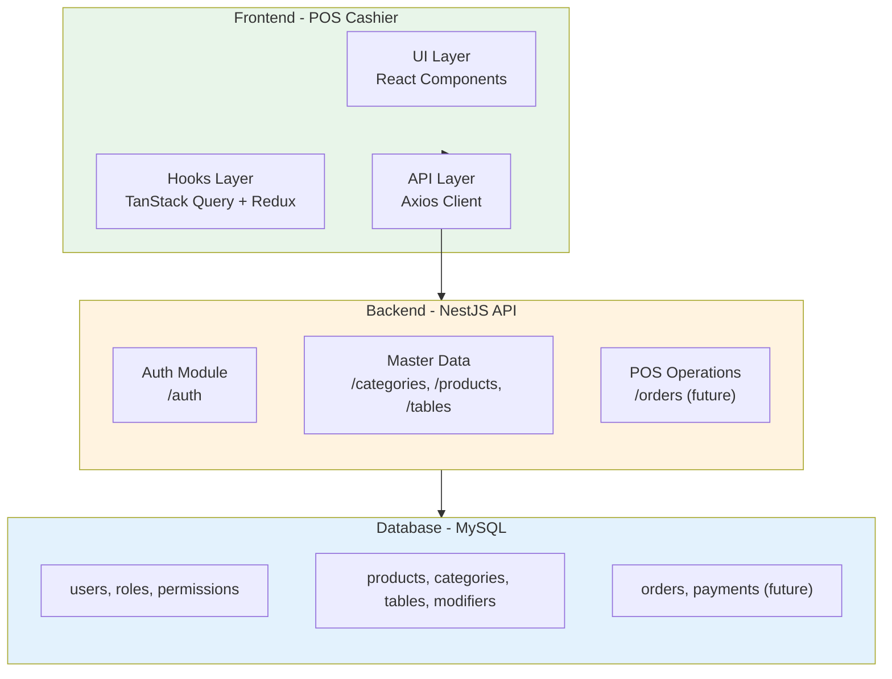
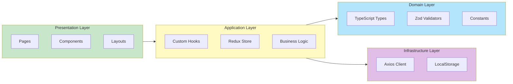
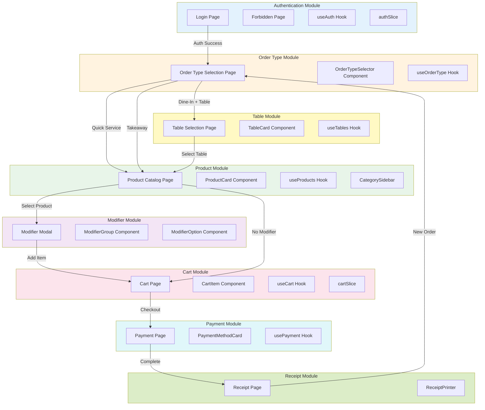
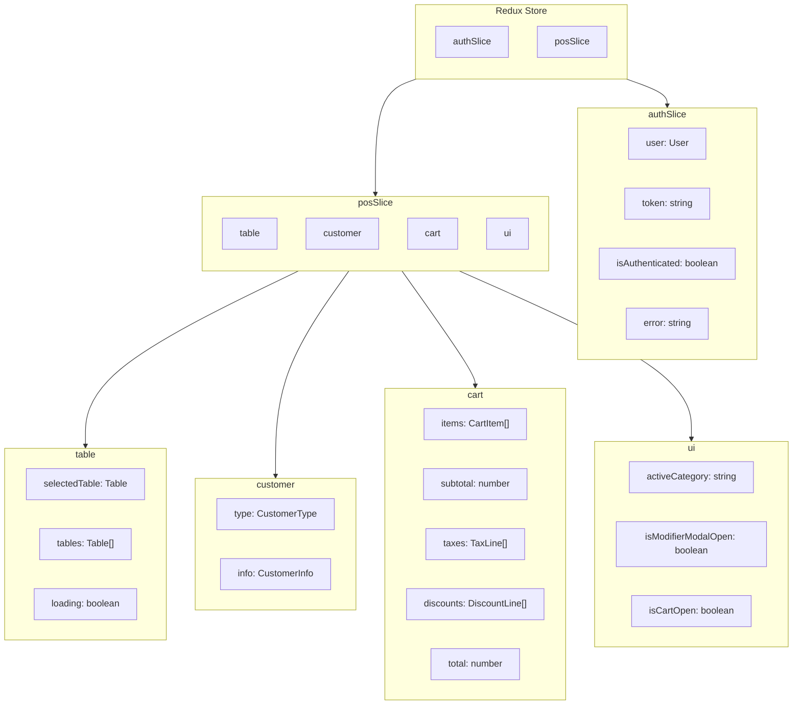
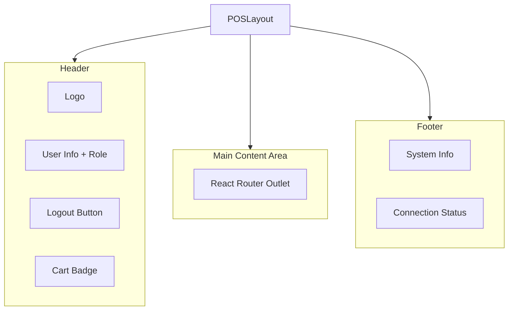
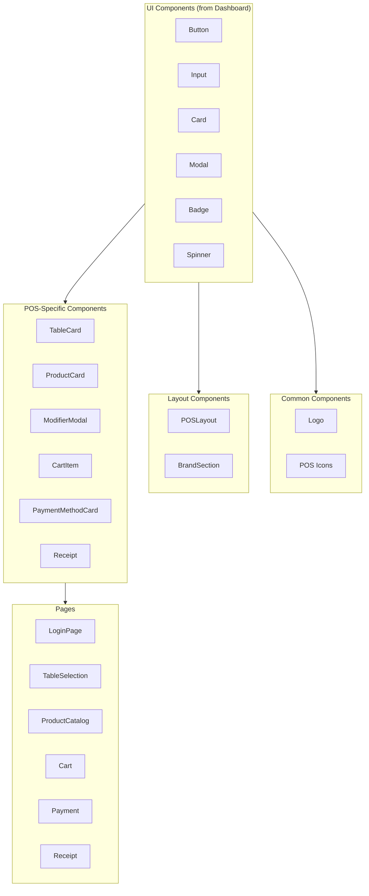
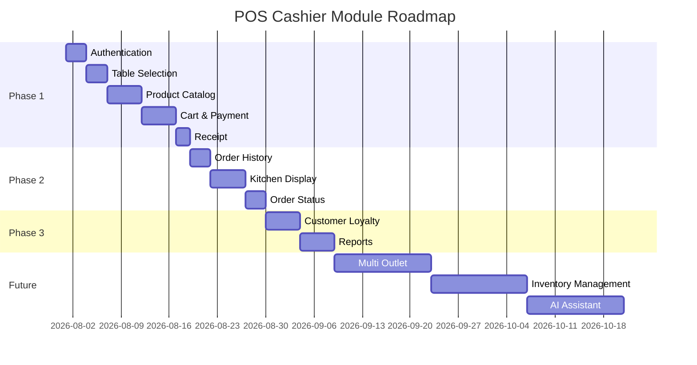

# POS Cashier Blueprint

> **Document Version**: 1.1.0
> **Last Updated**: 2026-08-06
> **Reference**: RESTAURANT_POS_DATABASE_BLUEPRINT.md

---

## Table of Contents

1. [Overview](#overview)
2. [Architecture Diagram](#architecture-diagram)
3. [Module Structure](#module-structure)
4. [State Management](#state-management)
5. [Route Configuration](#route-configuration)
6. [Layout Structure](#layout-structure)
7. [Reusable Components](#reusable-components)
8. [Reusable Hooks](#reusable-hooks)
9. [API Integration](#api-integration)
10. [Folder Structure](#folder-structure)
11. [Future Modules](#future-modules)

---

## Overview

POS Cashier Blueprint adalah dokumen arsitektur yang menjelaskan struktur lengkap aplikasi POS Cashier. Blueprint ini mengikuti pattern dari Dashboard Admin dan Single Source of Truth dari RESTAURANT_POS_DATABASE_BLUEPRINT.md.

### Goals

1. **Consistency** - Menggunakan pattern yang sama dengan Dashboard
2. **Maintainability** - Kode yang mudah dipelihara
3. **Scalability** - Support pengembangan future modules
4. **Performance** - Optimized untuk Point of Sale operations

### Order Types

POS Cashier mendukung tiga tipe order:

| Type | Description | Table Required | Use Case |
|------|-------------|----------------|----------|
| `dine_in` + `with_table` | Dine-In dengan meja | ✅ Yes | Restaurant, fine dining |
| `dine_in` + `quick_service` | Dine-In tanpa meja | ❌ No | Café, fast food |
| `takeaway` | Bawa pulang | ❌ No | Grab food, delivery |

---

## Architecture Diagram

### System Architecture



### Component Architecture



---

## Module Structure

### POS Module Overview



---

## State Management

### Redux Store Structure



### State Types

```typescript
// Order Types
enum OrderType {
  DINE_IN = 'dine_in',
  TAKEAWAY = 'takeaway'
}

enum DineInMode {
  WITH_TABLE = 'with_table',
  QUICK_SERVICE = 'quick_service'
}

// store/index.ts
interface RootState {
  auth: AuthState;
  pos: POSState;
}

// store/slices/authSlice.ts
interface AuthState {
  user: User | null;
  token: string | null;
  isAuthenticated: boolean;
  isLoading: boolean;
  error: string | null;
}

// store/slices/posSlice.ts
interface POSState {
  // Order Type
  orderType: OrderType | null;       // dine_in, takeaway
  dineInMode: DineInMode | null;     // with_table, quick_service

  // Table (only for dine_in with_table)
  selectedTable: DiningTable | null;
  tables: DiningTable[];
  tablesLoading: boolean;

  // Customer
  customer: Customer;

  // Cart
  cart: Cart | null;
  isCartOpen: boolean;

  // UI State
  activeCategory: string | null;
  isModifierModalOpen: boolean;
  selectedProduct: Product | null;

  // Loading
  isLoading: boolean;
  isProcessing: boolean;
}
```

### Redux Slices

```typescript
// store/slices/posSlice.ts
const posSlice = createSlice({
  name: 'pos',
  initialState,
  reducers: {
    // Order Type Actions
    setOrderType: (state, action: PayloadAction<OrderType>) => {
      state.orderType = action.payload;
    },
    setDineInMode: (state, action: PayloadAction<DineInMode>) => {
      state.dineInMode = action.payload;
      // Clear table if switching to quick_service
      if (action.payload === DineInMode.QUICK_SERVICE) {
        state.selectedTable = null;
      }
    },
    clearOrderType: (state) => {
      state.orderType = null;
      state.dineInMode = null;
      state.selectedTable = null;
    },

    // Table Actions (only for dine_in with_table)
    setTables: (state, action: PayloadAction<DiningTable[]>) => {
      state.tables = action.payload;
    },
    selectTable: (state, action: PayloadAction<DiningTable>) => {
      state.selectedTable = action.payload;
    },
    clearTable: (state) => {
      state.selectedTable = null;
    },

    // Cart Actions
    addToCart: (state, action: PayloadAction<CartItem>) => {
      if (!state.cart) {
        state.cart = createEmptyCart();
      }
      state.cart.items.push(action.payload);
      state.cart.subtotal = calculateSubtotal(state.cart.items);
    },
    updateCartItem: (state, action: PayloadAction<CartItem>) => {
      const index = state.cart?.items.findIndex(i => i.id === action.payload.id);
      if (index !== undefined && state.cart) {
        state.cart.items[index] = action.payload;
        state.cart.subtotal = calculateSubtotal(state.cart.items);
      }
    },
    removeFromCart: (state, action: PayloadAction<string>) => {
      if (state.cart) {
        state.cart.items = state.cart.items.filter(i => i.id !== action.payload);
        state.cart.subtotal = calculateSubtotal(state.cart.items);
      }
    },
    clearCart: (state) => {
      state.cart = null;
    },

    // Tax & Discount
    setTaxes: (state, action: PayloadAction<TaxLine[]>) => {
      if (state.cart) {
        state.cart.taxes = action.payload;
        state.cart.total = calculateTotal(state.cart);
      }
    },
    applyDiscount: (state, action: PayloadAction<Discount>) => {
      if (state.cart) {
        state.cart.discounts = [action.payload];
        state.cart.total = calculateTotal(state.cart);
      }
    },
    removeDiscount: (state) => {
      if (state.cart) {
        state.cart.discounts = [];
        state.cart.total = calculateTotal(state.cart);
      }
    },

    // UI Actions
    setActiveCategory: (state, action: PayloadAction<string>) => {
      state.activeCategory = action.payload;
    },
    openModifierModal: (state, action: PayloadAction<Product>) => {
      state.isModifierModalOpen = true;
      state.selectedProduct = action.payload;
    },
    closeModifierModal: (state) => {
      state.isModifierModalOpen = false;
      state.selectedProduct = null;
    },
    toggleCart: (state) => {
      state.isCartOpen = !state.isCartOpen;
    },
  },
});
```

---

## Route Configuration

### Route Structure

```typescript
// routes/AppRoutes.tsx
const AppRoutes: React.FC = () => {
  return (
    <Routes>
      {/* Public Routes */}
      <Route path="/login" element={<PublicRoute><LoginPage /></PublicRoute>} />
      <Route path="/forbidden" element={<ProtectedRoute><ForbiddenPage /></ProtectedRoute>} />

      {/* POS Routes */}
      <Route path="/pos" element={<ProtectedRoute><POSLayout /></ProtectedRoute>}>
        <Route index element={<POSTerminal />} />
        <Route path="tables" element={<TableSelection />} />
        <Route path="products" element={<ProductCatalog />} />
        <Route path="cart" element={<Cart />} />
        <Route path="payment" element={<Payment />} />
        <Route path="receipt/:orderId" element={<Receipt />} />
        <Route path="history" element={<OrderHistory />} />
        <Route path="profile" element={<Profile />} />
      </Route>

      {/* Redirects */}
      <Route path="/" element={<Navigate to="/login" replace />} />
      <Route path="*" element={<Navigate to="/login" replace />} />
    </Routes>
  );
};
```

### Route Guards

```typescript
// Protected Route - Checks authentication & cashier permission
function ProtectedRoute({ children }) {
  const { isAuthenticated, user } = useSelector((state: RootState) => state.auth);

  if (!isAuthenticated) {
    return <Navigate to="/login" />;
  }

  const hasCashierPerm = user?.role?.permissions?.includes('use_cashier');
  if (!hasCashierPerm) {
    return <Navigate to="/forbidden" />;
  }

  return children;
}
```

---

## Layout Structure

### POS Layout Hierarchy



### POS Layout Component

```typescript
// components/layout/POSLayout.tsx
interface POSLayoutProps {
  children: React.ReactNode;
}

export function POSLayout({ children }: POSLayoutProps) {
  const { user } = useSelector((state: RootState) => state.auth);
  const { cart } = useSelector((state: RootState) => state.pos);
  const logoutMutation = useLogout();

  const handleLogout = () => {
    logoutMutation.mutate(undefined, {
      onSuccess: () => navigate('/login'),
    });
  };

  return (
    <div className="min-h-screen bg-slate-100 flex flex-col">
      {/* Header */}
      <header className="bg-white border-b border-slate-200 sticky top-0 z-50">
        <div className="max-w-7xl mx-auto px-4 h-16 flex items-center justify-between">
          <Logo />
          <div className="flex items-center gap-4">
            <UserBadge user={user} />
            <CartBadge count={cart?.items.length ?? 0} />
            <LogoutButton onClick={handleLogout} />
          </div>
        </div>
      </header>

      {/* Main Content */}
      <main className="flex-1">
        {children}
      </main>

      {/* Footer */}
      <footer className="bg-white border-t border-slate-200 py-4">
        <POSFooter />
      </footer>
    </div>
  );
}
```

---

## Reusable Components

### Component Hierarchy



### Component Specifications

#### 1. TableCard

```typescript
// components/pos/TableCard.tsx
interface TableCardProps {
  table: DiningTable;
  onSelect: (table: DiningTable) => void;
  isSelected?: boolean;
}

export function TableCard({ table, onSelect, isSelected }: TableCardProps) {
  const statusColors = {
    available: 'bg-green-100 text-green-700 border-green-200',
    occupied: 'bg-red-100 text-red-700 border-red-200',
    reserved: 'bg-orange-100 text-orange-700 border-orange-200',
    maintenance: 'bg-gray-100 text-gray-500 border-gray-200',
  };

  return (
    <Card
      className={cn(
        'cursor-pointer transition-all hover:scale-105',
        table.status === 'available' ? 'hover:shadow-lg' : 'opacity-60 cursor-not-allowed'
      )}
      onClick={() => table.status === 'available' && onSelect(table)}
    >
      <CardBody className="p-4 text-center">
        <div className="text-2xl font-bold">{table.tableCode}</div>
        <div className="text-sm text-slate-500">{table.areaName}</div>
        <Badge className={cn('mt-2', statusColors[table.status])}>
          {table.status}
        </Badge>
        <div className="mt-2 text-xs text-slate-400">
          {table.capacity} seats
        </div>
      </CardBody>
    </Card>
  );
}
```

#### 2. ProductCard

```typescript
// components/pos/ProductCard.tsx
interface ProductCardProps {
  product: Product;
  onSelect: (product: Product) => void;
}

export function ProductCard({ product, onSelect }: ProductCardProps) {
  return (
    <Card
      className={cn(
        'cursor-pointer transition-all hover:scale-105 hover:shadow-lg',
        !product.isAvailable && 'opacity-50 cursor-not-allowed'
      )}
      onClick={() => product.isAvailable && onSelect(product)}
    >
      <div className="aspect-square relative">
        
        {!product.isAvailable && (
          <div className="absolute inset-0 bg-black/50 flex items-center justify-center">
            <Badge variant="danger">Sold Out</Badge>
          </div>
        )}
        {product.hasVariants && (
          <div className="absolute top-2 right-2">
            <Badge variant="info">+Options</Badge>
          </div>
        )}
      </div>
      <CardBody className="p-3">
        <div className="font-medium text-slate-900 truncate">{product.name}</div>
        <div className="text-lg font-bold text-indigo-600">
          {formatCurrency(product.price)}
        </div>
      </CardBody>
    </Card>
  );
}
```

#### 3. ModifierModal

```typescript
// components/pos/ModifierModal.tsx
interface ModifierModalProps {
  product: Product;
  isOpen: boolean;
  onClose: () => void;
  onAdd: (item: CartItem) => void;
}

export function ModifierModal({ product, isOpen, onClose, onAdd }: ModifierModalProps) {
  const [quantity, setQuantity] = useState(1);
  const [selectedModifiers, setSelectedModifiers] = useState<Map<string, string[]>>(new Map());
  const [notes, setNotes] = useState('');

  // Validate required modifiers
  const isValid = product.modifierGroups
    .filter(g => g.isRequired)
    .every(g => selectedModifiers.has(g.id));

  const totalPrice = calculateItemTotal(product.price, selectedModifiers, product.modifierGroups, quantity);

  return (
    <Modal isOpen={isOpen} onClose={onClose} title={product.name}>
      <div className="space-y-6">
        {/* Modifier Groups */}
        {product.modifierGroups.map(group => (
          <ModifierGroup
            key={group.id}
            group={group}
            selected={selectedModifiers.get(group.id) || []}
            onChange={(values) => {
              const newMap = new Map(selectedModifiers);
              newMap.set(group.id, values);
              setSelectedModifiers(newMap);
            }}
          />
        ))}

        {/* Special Notes */}
        <Textarea
          label="Special Request"
          value={notes}
          onChange={(e) => setNotes(e.target.value)}
          placeholder="Any special instructions..."
        />

        {/* Quantity */}
        <div className="flex items-center justify-between">
          <span className="font-medium">Quantity</span>
          <QuantityStepper value={quantity} onChange={setQuantity} />
        </div>

        {/* Total */}
        <div className="text-xl font-bold text-right">
          Total: {formatCurrency(totalPrice)}
        </div>

        {/* Actions */}
        <div className="flex gap-3">
          <Button variant="secondary" onClick={onClose} className="flex-1">
            Cancel
          </Button>
          <Button
            variant="primary"
            onClick={() => onAdd(createCartItem(product, quantity, selectedModifiers, notes))}
            disabled={!isValid}
            className="flex-1"
          >
            Add to Cart
          </Button>
        </div>
      </div>
    </Modal>
  );
}
```

---

## Reusable Hooks

### Hooks Structure

```typescript
// hooks/
export * from './useAuth';
export * from './usePermission';
export * from './useDocumentTitle';
export * from './useTables';
export * from './useProducts';
export * from './useCart';
export * from './useModifiers';
export * from './usePayment';
```

### Custom Hooks Specification

#### 1. useTables

```typescript
// hooks/useTables.ts
export function useTables() {
  return useQuery({
    queryKey: ['tables'],
    queryFn: () => getTables(),
    select: (data) => data.filter(t => t.status === 'available'),
  });
}

export function useAreas() {
  return useQuery({
    queryKey: ['table-areas'],
    queryFn: () => getAreas(),
  });
}
```

#### 2. useProducts

```typescript
// hooks/useProducts.ts
export function useCategories() {
  return useQuery({
    queryKey: ['categories'],
    queryFn: () => getCategories(),
  });
}

export function useProducts(categoryId?: string) {
  return useQuery({
    queryKey: ['products', categoryId],
    queryFn: () => getProducts({ category_id: categoryId }),
    enabled: !!categoryId,
  });
}

export function useProduct(id: string) {
  return useQuery({
    queryKey: ['product', id],
    queryFn: () => getProduct(id),
    enabled: !!id,
  });
}
```

#### 3. useCart

```typescript
// hooks/useCart.ts
export function useCart() {
  return useSelector((state: RootState) => state.pos.cart);
}

export function useCartCalculations() {
  const cart = useCart();
  const taxes = useTaxes();
  const discounts = useDiscounts();

  const subtotal = cart?.subtotal ?? 0;
  const taxAmount = calculateTaxes(subtotal, taxes);
  const discountAmount = calculateDiscounts(subtotal, discounts);
  const total = subtotal + taxAmount - discountAmount;

  return { subtotal, taxAmount, discountAmount, total };
}
```

#### 4. usePayment

```typescript
// hooks/usePayment.ts
export function usePaymentMethods() {
  return useQuery({
    queryKey: ['payment-methods'],
    queryFn: () => getPaymentMethods(),
  });
}

export function useProcessPayment() {
  const queryClient = useQueryClient();

  return useMutation({
    mutationFn: (data: PaymentRequest) => processPayment(data),
    onSuccess: () => {
      queryClient.invalidateQueries({ queryKey: ['orders'] });
    },
  });
}
```

---

## API Integration

### API Client Setup

```typescript
// api/client.ts
const BASE_URL = import.meta.env.VITE_API_URL || 'http://localhost:3000/api';

export const apiClient = axios.create({
  baseURL: BASE_URL,
  timeout: 30000,
  headers: {
    'Content-Type': 'application/json',
  },
});

// Request interceptor
apiClient.interceptors.request.use((config) => {
  const token = store.getState().auth.token;
  if (token) {
    config.headers.Authorization = `Bearer ${token}`;
  }
  return config;
});

// Response interceptor
apiClient.interceptors.response.use(
  (response) => response,
  (error) => {
    if (error.response?.status === 401) {
      store.dispatch(logout());
      window.location.href = '/login';
    }
    return Promise.reject(error);
  }
);
```

### API Functions

```typescript
// api/tables.api.ts
export const getTables = async () => {
  const response = await apiClient.get('/dining-tables/active');
  return response.data.data;
};

export const getAreas = async () => {
  const response = await apiClient.get('/dining-tables/areas');
  return response.data.data.map((a: any) => a.areaName);
};

// api/products.api.ts
export const getCategories = async () => {
  const response = await apiClient.get('/categories/active');
  return response.data.data;
};

export const getProducts = async (params?: { category_id?: string }) => {
  const searchParams = new URLSearchParams();
  if (params?.category_id) searchParams.set('category_id', params.category_id);

  const response = await apiClient.get(`/products/active?${searchParams}`);
  return response.data.data;
};

export const getProduct = async (id: string) => {
  const response = await apiClient.get(`/products/${id}`);
  return response.data.data;
};
```

---

## Folder Structure

### Complete Structure

```
pos-cashier/
├── src/
│   ├── api/                      # API Layer
│   │   ├── client.ts            # Axios instance
│   │   ├── tables.api.ts        # Table API functions
│   │   ├── products.api.ts      # Product API functions
│   │   ├── orders.api.ts        # Order API functions (future)
│   │   └── index.ts
│   │
│   ├── components/
│   │   ├── ui/                  # Reusable UI (from Dashboard)
│   │   │   ├── Button.tsx
│   │   │   ├── Input.tsx
│   │   │   ├── Card.tsx
│   │   │   ├── Modal.tsx
│   │   │   ├── Badge.tsx
│   │   │   ├── Spinner.tsx
│   │   │   └── index.ts
│   │   │
│   │   ├── common/              # Shared components
│   │   │   └── Logo.tsx
│   │   │
│   │   ├── layout/              # Layout components
│   │   │   ├── POSLayout.tsx
│   │   │   ├── POSHeader.tsx
│   │   │   ├── POSFooter.tsx
│   │   │   ├── UserBadge.tsx
│   │   │   ├── CartBadge.tsx
│   │   │   └── BrandSection.tsx
│   │   │
│   │   └── pos/                 # POS-specific components
│   │       ├── tables/
│   │       │   ├── TableCard.tsx
│   │       │   ├── TableGrid.tsx
│   │       │   └── AreaTabs.tsx
│   │       ├── products/
│   │       │   ├── ProductCard.tsx
│   │       │   ├── ProductGrid.tsx
│   │       │   └── CategorySidebar.tsx
│   │       ├── modifiers/
│   │       │   ├── ModifierModal.tsx
│   │       │   ├── ModifierGroup.tsx
│   │       │   └── ModifierOption.tsx
│   │       ├── cart/
│   │       │   ├── CartItem.tsx
│   │       │   ├── CartSummary.tsx
│   │       │   └── CartList.tsx
│   │       ├── payment/
│   │       │   ├── PaymentMethodCard.tsx
│   │       │   ├── CashPanel.tsx
│   │       │   └── CardPanel.tsx
│   │       └── receipt/
│   │           ├── Receipt.tsx
│   │           └── ReceiptPrinter.tsx
│   │
│   ├── hooks/                   # Application Layer
│   │   ├── useAuth.ts          # Auth hooks
│   │   ├── usePermission.ts     # RBAC hooks
│   │   ├── useDocumentTitle.ts
│   │   ├── useTables.ts        # Table hooks
│   │   ├── useProducts.ts       # Product hooks
│   │   ├── useCart.ts           # Cart hooks
│   │   ├── useModifiers.ts      # Modifier hooks
│   │   └── usePayment.ts        # Payment hooks
│   │
│   ├── pages/                   # Presentation Layer
│   │   ├── Login/
│   │   │   ├── LoginPage.tsx
│   │   │   ├── LoginForm.tsx
│   │   │   └── LoginCard.tsx
│   │   ├── Forbidden/
│   │   │   └── ForbiddenPage.tsx
│   │   ├── POS/
│   │   │   ├── POSTerminal.tsx
│   │   │   ├── TableSelection.tsx
│   │   │   ├── ProductCatalog.tsx
│   │   │   ├── Cart.tsx
│   │   │   ├── Payment.tsx
│   │   │   ├── Receipt.tsx
│   │   │   ├── OrderHistory.tsx
│   │   │   └── Profile.tsx
│   │   └── index.ts
│   │
│   ├── routes/                  # Routing
│   │   ├── AppRoutes.tsx
│   │   └── constants.ts
│   │
│   ├── store/                   # State Management
│   │   ├── index.ts
│   │   └── slices/
│   │       ├── authSlice.ts
│   │       └── posSlice.ts
│   │
│   ├── types/                   # Domain Layer
│   │   ├── auth.ts
│   │   ├── product.ts
│   │   ├── table.ts
│   │   ├── cart.ts
│   │   ├── payment.ts
│   │   └── index.ts
│   │
│   ├── utils/                   # Utilities
│   │   ├── cn.ts
│   │   ├── formatters.ts        # Currency, date formatters
│   │   ├── validators.ts
│   │   └── calculations.ts       # Tax, discount calculations
│   │
│   ├── constants/                # Constants
│   │   └── index.ts
│   │
│   ├── App.tsx
│   ├── main.tsx
│   └── index.css
│
├── docs/                        # Documentation
│   ├── CLAUDE.md
│   ├── POS_BUSINESS_FLOW.md
│   ├── POS_SCREEN_FLOW.md
│   ├── POS_API_FLOW.md
│   └── POS_BLUEPRINT.md
│
├── package.json
├── vite.config.ts
├── tsconfig.json
└── CLAUDE.md
```

---

## Future Modules

### Module Roadmap



### Phase 1 - Core POS
- [x] Authentication
- [x] Forbidden Page
- [x] POS Layout
- [ ] Table Selection
- [ ] Product Catalog
- [ ] Modifier Selection
- [ ] Cart Management
- [ ] Tax & Discount
- [ ] Payment Processing
- [ ] Receipt Generation

### Phase 2 - Operations
- [ ] Order History
- [ ] Kitchen Display System (KDS)
- [ ] Order Status Tracking
- [ ] Void/Refund

### Phase 3 - Enhancement
- [ ] Customer Loyalty
- [ ] Reports & Analytics
- [ ] Print Configuration

### Future - Enterprise
- [ ] Multi Outlet Support
- [ ] Inventory Management
- [ ] AI Assistant
- [ ] Customer Loyalty Program
- [ ] Mobile POS

---

## Appendix

### Related Documents

1. [CLAUDE.md](../CLAUDE.md)
2. [POS_BUSINESS_FLOW.md](./POS_BUSINESS_FLOW.md)
3. [POS_SCREEN_FLOW.md](./POS_SCREEN_FLOW.md)
4. [POS_API_FLOW.md](./POS_API_FLOW.md)
5. [RESTAURANT_POS_DATABASE_BLUEPRINT.md](../../docs/RESTAURANT_POS_DATABASE_BLUEPRINT.md)

### Revision History

| Version | Date | Author | Changes |
|---------|------|--------|---------|
| 1.0.0 | 2026-08-06 | System | Initial document |
