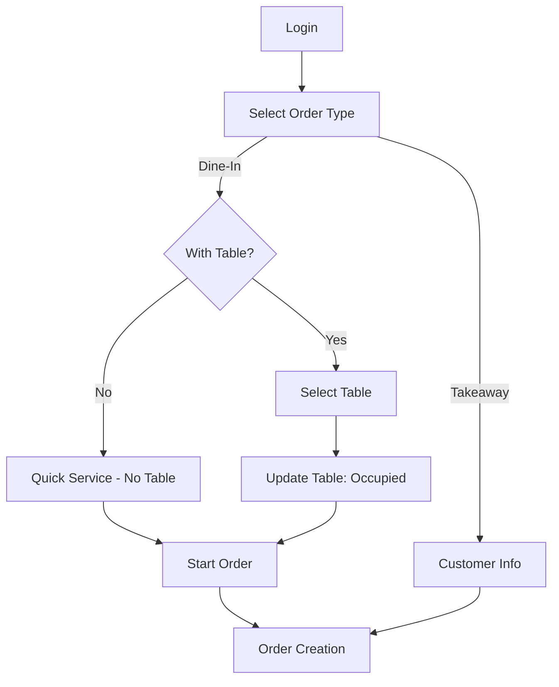
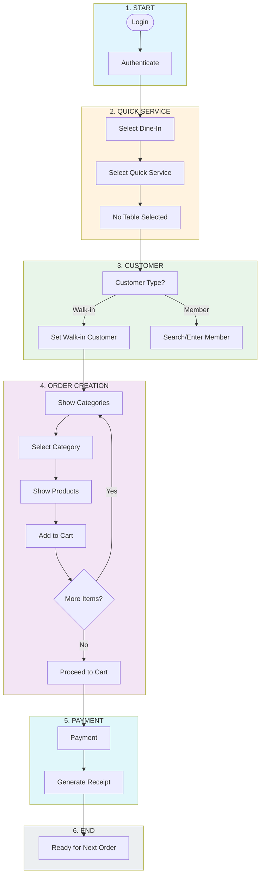
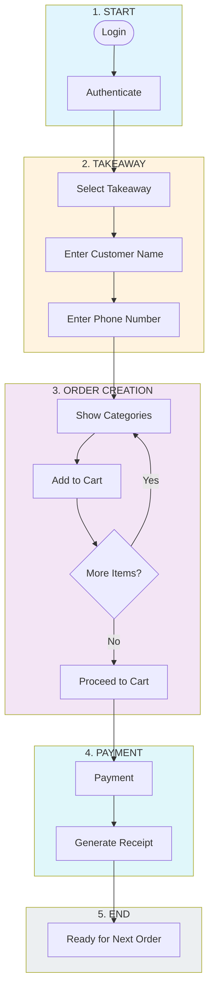
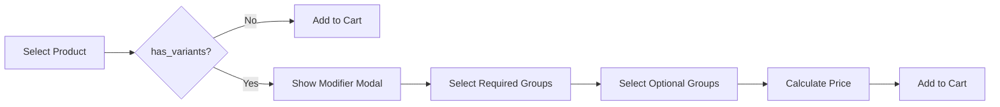
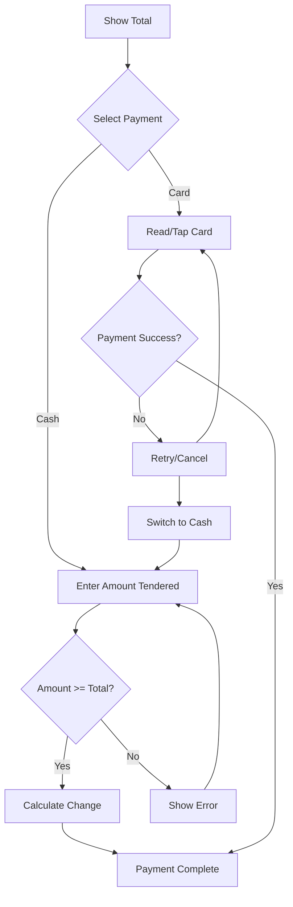

# POS Business Flow Documentation

> **Document Version**: 1.1.0
> **Last Updated**: 2026-08-06
> **Reference**: RESTAURANT_POS_DATABASE_BLUEPRINT.md

---

## Table of Contents

1. [Overview](#overview)
2. [Order Types](#order-types)
3. [Business Flow Diagram](#business-flow-diagram)
4. [Detailed Flow Steps](#detailed-flow-steps)
5. [Business Rules](#business-rules)
6. [State Management](#state-management)
7. [Error Handling](#error-handling)

---

## Overview

POS Cashier Business Flow adalah alur kerja lengkap untuk transaksi Point of Sale di restoran. Flow ini menghubungkan seluruh module yang sudah ada: Products, Categories, Dining Tables, Modifiers, Taxes, Discounts, dan Payment Methods.

### Goals

1. **Fast Transaction** - Minimalkan waktu checkout
2. **Accurate** - Perhitungan otomatis yang tepat
3. **Flexible** - Support berbagai skenario order
4. **Audit Trail** - Track setiap transaksi

---

## Order Types

POS Cashier mendukung dua tipe order utama:

```typescript
enum OrderType {
  DINE_IN = 'dine_in',      // Pelanggan duduk di meja
  TAKEAWAY = 'takeaway',    // Pelanggan bawa pulang
}

enum DineInMode {
  WITH_TABLE = 'with_table',  // Pilih meja (restoran formal)
  QUICK_SERVICE = 'quick_service'  // Tanpa pilih meja (café/fast food)
}
```

### Order Type Flow



### Order Type Comparison

| Aspect | Dine-In (With Table) | Dine-In (Quick Service) | Takeaway |
|--------|---------------------|------------------------|----------|
| Table Selection | ✅ Required | ❌ Not Required | ❌ Not Required |
| Customer Name | Optional | Optional | ✅ Required |
| Receipt Print | ✅ Recommended | Optional | ✅ Recommended |
| Table Update | On order complete | N/A | N/A |
| Use Case | Restaurant, fine dining | Café, fast food | Grab food, delivery |

---

## Business Flow Diagram

### Full Flow (Dine-In With Table)

```mermaid
flowchart TD
    subgraph START["1. START"]
        A1([Login]) --> A2[Authenticate]
    end

    subgraph ORDER_TYPE["2. ORDER TYPE"]
        A2 --> B1[Select Order Type]
        B1 -->|Dine-In| B2{Select Table?}
        B2 -->|Yes| B3[Select Table]
        B2 -->|No| B4[Quick Service]
        B3 --> B5[Update Table: Occupied]
        B4 --> B5
        B1 -->|Takeaway| B6[Enter Customer Info]
    end

    subgraph CUSTOMER["3. CUSTOMER"]
        B5 --> C1[Customer Type?]
        B6 --> C1
        C1 -->|Walk-in| C2[Set Walk-in Customer]
        C1 -->|Member| C2A[Search/Enter Member]
    end

    subgraph ORDER["4. ORDER CREATION"]
        C2 --> D1[Show Categories]
        D1 --> D2[Select Category]
        D2 --> D3[Show Products]
        D3 --> D4{Select Product}
        D4 -->|Has Modifiers| D5[Show Modifier Groups]
        D5 --> D6[Select Modifiers]
        D6 --> D7[Add to Cart]
        D4 -->|No Modifiers| D7
        D7 --> D8{More Items?}
        D8 -->|Yes| D1
        D8 -->|No| D9[Proceed to Cart]
    end

    subgraph ADJUST["5. ADJUSTMENTS"]
        D9 --> E1[Review Cart]
        E1 --> E2[Apply Tax?]
        E2 -->|Yes| E3[Auto Calculate Tax]
        E3 --> E4
        E2 -->|No| E4
        E4[Apply Discount?] -->|Yes| E5[Select/Enter Discount]
        E5 --> E6[Calculate Total]
        E6 --> E7
        E4 -->|No| E7[Show Final Total]
    end

    subgraph PAYMENT["6. PAYMENT"]
        E7 --> F1[Select Payment Method]
        F1 --> F2{Payment Type?}
        F2 -->|Cash| F3[Enter Amount]
        F3 --> F4[Calculate Change]
        F2 -->|Card| F5[Enter Reference]
        F5 --> F6[Process Card Payment]
        F6 --> F7[Payment Success]
        F3 --> F7
    end

    subgraph COMPLETE["7. COMPLETION"]
        F7 --> G1[Generate Receipt]
        G1 --> G2{Print Receipt?}
        G2 -->|Yes| G3[Print]
        G2 -->|No| G4[Send to Email/SMS]
        G4 --> G5{Update Table?}
        G3 --> G5
        G5 -->|Yes| G6[Update Table: Available]
        G5 -->|No| G7[Order Complete]
        G6 --> G7
    end

    subgraph END["8. END"]
        G7 --> H1[Ready for Next Order]
    end

    style START fill:#e1f5fe
    style ORDER_TYPE fill:#fff3e0
    style CUSTOMER fill:#e8f5e9
    style ORDER fill:#f3e5f5
    style ADJUST fill:#fce4ec
    style PAYMENT fill:#e0f7fa
    style COMPLETE fill:#f1f8e9
    style END fill:#eceff1
```



### Quick Service Flow (Dine-In Without Table)



### Takeaway Flow


    end

    style START fill:#e1f5fe
    style SELECT fill:#fff3e0
    style CUSTOMER fill:#e8f5e9
    style ORDER fill:#f3e5f5
    style ADJUST fill:#fce4ec
    style PAYMENT fill:#e0f7fa
    style COMPLETE fill:#f1f8e9
    style END fill:#eceff1
```

---

## Detailed Flow Steps

### 1. START - Login

#### Flow
```
Cashier opens POS → Enter credentials → POST /auth/login
```

#### Request
```json
{
  "email": "cashier@nexus.com",
  "password": "cashier123",
  "app": "pos"
}
```

#### Response
```json
{
  "success": true,
  "data": {
    "accessToken": "jwt_token_here",
    "user": {
      "id": "uuid",
      "name": "Cashier Name",
      "role": { "code": "cashier" }
    }
  }
}
```

#### Validation
- [ ] Email format valid
- [ ] Password minimum 6 characters
- [ ] User has `use_cashier` permission
- [ ] User role is `cashier`

#### Error Handling
| Error | Response |
|-------|----------|
| Invalid credentials | `401: Invalid credentials` |
| No cashier permission | `403: You do not have permission to access POS Cashier` |
| Inactive user | `401: User account is inactive` |

---

### 2. ORDER TYPE SELECTION

Setelah login, cashier harus memilih tipe order. POS mendukung tiga mode:

#### 2.1 Dine-In (With Table)

Pilih meja terlebih dahulu sebelum order.

**Flow:**
```
Login Success → Select "Dine-In" → Select "With Table"
→ Show Available Tables → Select Table → Update Table Status
```

**API Calls:**
```typescript
// Get active tables
GET /dining-tables/active

// Response
{
  "data": [
    {
      "id": "uuid",
      "table_code": "T01",
      "table_name": "Table 1",
      "area_name": "Indoor",
      "capacity": 4,
      "status": "available"
    }
  ]
}
```

**Table Status:**
| Status | Description | Color |
|--------|-------------|-------|
| `available` | Ready for customers | Green |
| `occupied` | Currently in use | Red |
| `reserved` | Reserved for booking | Orange |
| `maintenance` | Not available | Gray |

**Business Rules:**
| Code | Rule | Reference |
|------|------|-----------|
| TR-001 | Only show tables with status `available` | Default view |
| TR-002 | Occupied table cannot be selected | Block selection |
| TR-004 | Table status updated to `occupied` after order |

---

#### 2.2 Dine-In (Quick Service)

Tanpa pilih meja - cocok untuk café atau fast food.

**Flow:**
```
Login Success → Select "Dine-In" → Select "Quick Service"
→ No Table Selected → Proceed to Order
```

**Characteristics:**
| Aspect | Value |
|--------|-------|
| Table Required | ❌ No |
| Customer Name | Optional |
| Receipt | Digital only |
| Table Update | Not required |

**Business Rules:**
| Code | Rule |
|------|------|
| QS-001 | Order proceeds without table selection |
| QS-002 | Order type = `dine_in` dengan `mode = 'quick_service'` |
| QS-003 | No table status update on order completion |

**State:**
```typescript
const quickServiceOrder = {
  orderType: 'dine_in',
  dineInMode: 'quick_service',
  tableId: null,
  tableName: 'Quick Service'
};
```

---

#### 2.3 Takeaway

Pelanggan bawa pulang - harus isi data customer.

**Flow:**
```
Login Success → Select "Takeaway"
→ Enter Customer Name → Enter Phone (Optional)
→ Proceed to Order
```

**Required Fields:**
| Field | Required | Validation |
|-------|----------|------------|
| Customer Name | ✅ Yes | Min 2 characters |
| Phone Number | Optional | Valid phone format |

**Business Rules:**
| Code | Rule |
|------|------|
| TW-001 | Customer name is mandatory |
| TW-002 | Order type = `takeaway` |
| TW-003 | No table assignment |
| TW-004 | Receipt should show customer name |

**State:**
```typescript
const takeawayOrder = {
  orderType: 'takeaway',
  dineInMode: null,
  tableId: null,
  customer: {
    name: 'John Doe',
    phone: '+6281234567890'
  }
};
```

---

### 3. CUSTOMER SELECTION

#### Flow
```
Select Order Type → Choose Customer Type → Walk-in Default
```

#### Customer Types
```typescript
enum CustomerType {
  WALK_IN = 'walk_in',
  MEMBER = 'member',
  GUEST = 'guest'
}
```

#### Default: Walk-in
```typescript
const defaultCustomer = {
  id: 'walk-in',
  name: 'Walk-in Customer',
  type: CustomerType.WALK_IN
};
```

#### Business Rules
| Code | Rule |
|------|------|
| CR-001 | Default customer type is Walk-in |
| CR-002 | Member lookup by phone/email |
| CR-003 | Guest requires name entry |

---

### 4. PRODUCT SELECTION

#### Flow
```
Select Category → Show Products → Select Product → Check Modifiers
→ Add to Cart
```

#### API Calls
```typescript
// Get categories (for navigation)
GET /categories/active

// Get products by category
GET /products/active?category_id={id}

// Response
{
  "data": [
    {
      "id": "uuid",
      "name": "Nasi Goreng",
      "sku": "NG001",
      "price": 25000,
      "category": { "id": "uuid", "name": "Rice" },
      "has_variants": false,
      "is_available": true,
      "image_url": "https://..."
    }
  ]
}
```

#### Product Display
```typescript
interface ProductCard {
  id: string;
  name: string;
  price: number;
  image?: string;
  badge?: 'popular' | 'new' | 'sold_out';
  hasModifier: boolean;
}
```

#### Business Rules
| Code | Rule | Reference |
|------|------|-----------|
| PR-001 | Product must belong to exactly one category | PR-001 |
| PR-002 | Price format: Integer (Rupiah) | PR-002 |
| PR-005 | `is_available = FALSE` shows as Sold Out | PR-005 |
| MR-001 | Product with `has_variants = TRUE` requires modifier selection | MR-001 |

---

### 5. MODIFIER SELECTION

#### Flow
```
Select Product → Check has_variants → If TRUE → GET modifier-groups
→ Show Modifier Modal → Select Options → Add to Cart
```

#### API Calls
```typescript
// Get modifier groups for product
GET /modifier-groups/{product_id}

// Response
{
  "data": [
    {
      "id": "uuid",
      "name": "Level Pedas",
      "selection_type": "single",
      "is_required": true,
      "min_selections": 1,
      "max_selections": 1,
      "modifiers": [
        {
          "id": "uuid",
          "name": "Pedas",
          "additional_price": 0,
          "is_default": false
        },
        {
          "id": "uuid",
          "name": "Sangat Pedas",
          "additional_price": 2000,
          "is_default": false
        }
      ]
    }
  ]
}
```

#### Modifier Types
```typescript
enum SelectionType {
  SINGLE = 'single',   // Radio buttons
  MULTIPLE = 'multiple' // Checkboxes
}
```

#### Business Rules
| Code | Rule |
|------|------|
| MR-002 | Single-choice: exactly 1 modifier must be selected |
| MR-003 | Multi-choice: 0 to max_selections modifiers |
| MR-001 | Modifier adds to product price |

#### UI Flow


---

### 6. CART MANAGEMENT

#### Cart State Structure
```typescript
interface Cart {
  id: string;
  tableId: string;
  tableName: string;
  customer: Customer;
  items: CartItem[];
  subtotal: number;
  taxes: TaxLine[];
  discounts: DiscountLine[];
  total: number;
  createdAt: Date;
}

interface CartItem {
  id: string;
  productId: string;
  productName: string;
  quantity: number;
  unitPrice: number;
  modifiers: SelectedModifier[];
  itemTotal: number;
  notes?: string;
}

interface SelectedModifier {
  id: string;
  name: string;
  additionalPrice: number;
}
```

#### Cart Calculations
```typescript
// Item Total
itemTotal = unitPrice + sum(modifiers.additionalPrice) * quantity

// Subtotal
subtotal = sum(items.itemTotal)

// Tax Calculation
taxAmount = subtotal * taxRate

// Total
total = subtotal + taxAmount - discountAmount
```

#### Business Rules
| Code | Rule |
|------|------|
| CR-001 | Cart is table-specific |
| CR-002 | Cart persists until order completion |
| CR-003 | Quantity adjustment updates totals automatically |

---

### 7. TAX CALCULATION

#### Flow
```
Review Cart → Load Active Taxes → Calculate Per Product → Update Cart
```

#### API Calls
```typescript
// Get active taxes
GET /taxes/active

// Response
{
  "data": [
    {
      "id": "uuid",
      "code": "PB1",
      "name": "Pajak Pertambahan Nilai",
      "tax_type": "percentage",
      "rate": 0.11,
      "is_default": true
    }
  ]
}
```

#### Tax Calculation
```typescript
interface TaxCalculation {
  taxId: string;
  taxCode: string;
  taxName: string;
  rate: number;
  taxableAmount: number;
  taxAmount: number;
}

// Calculation
taxAmount = subtotal * tax.rate
```

#### Business Rules
| Code | Rule |
|------|------|
| TR-001 | Only `is_default = TRUE` tax applied automatically |
| TR-002 | Tax calculated on subtotal after modifiers |
| TR-003 | Tax displayed as separate line item |

---

### 8. DISCOUNT APPLICATION

#### Flow
```
Apply Discount? → Enter/Select Discount → Validate → Calculate → Update Total
```

#### API Calls
```typescript
// Get active discounts
GET /discounts/active

// Response
{
  "data": [
    {
      "id": "uuid",
      "code": "DISKON10",
      "name": "Diskon 10%",
      "discount_type": "percentage",
      "value": 10,
      "min_order_amount": 50000
    }
  ]
}
```

#### Discount Types
```typescript
enum DiscountType {
  PERCENTAGE = 'percentage',  // 10% off
  FIXED = 'fixed',            // Rp 10.000 off
  BUY_GET = 'buy_get'         // Buy 1 Get 1
}
```

#### Discount Calculation
```typescript
interface DiscountCalculation {
  discountId: string;
  discountCode: string;
  discountType: DiscountType;
  value: number;
  originalAmount: number;
  discountAmount: number;
}

// Percentage discount
discountAmount = subtotal * (value / 100)

// Fixed discount
discountAmount = value

// Validation
if (subtotal < discount.min_order_amount) {
  throw new Error('Minimum order not met');
}
```

#### Business Rules
| Code | Rule |
|------|------|
| DR-001 | Discount requires minimum order amount |
| DR-002 | Only one discount per order (configurable) |
| DR-003 | Discount code is case-insensitive |

---

### 9. PAYMENT

#### Flow
```
Show Total → Select Payment Method → Process Payment → Generate Receipt
```

#### API Calls
```typescript
// Get active payment methods
GET /payment-methods/active

// Response
{
  "data": [
    {
      "id": "uuid",
      "code": "CASH",
      "name": "Cash",
      "payment_type": "cash"
    },
    {
      "id": "uuid",
      "code": "DEBIT",
      "name": "Debit Card",
      "payment_type": "card"
    },
    {
      "id": "uuid",
      "code": "QRIS",
      "name": "QRIS",
      "payment_type": "qris"
    }
  ]
}
```

#### Payment Flow



#### Cash Payment
```typescript
interface CashPayment {
  method: 'CASH';
  amountTendered: number;
  change: number;
}

// Calculate change
change = amountTendered - total
```

#### Card Payment
```typescript
interface CardPayment {
  method: 'DEBIT' | 'CREDIT' | 'EWALLET';
  cardType: string;
  referenceNumber: string;
  transactionId: string;
}
```

#### QRIS Payment
```typescript
interface QRISPayment {
  method: 'QRIS';
  provider: 'DANA' | 'OVO' | 'GoPay' | 'ShopeePay';
  referenceNumber: string;
  qrCode: string;
}
```

#### Business Rules
| Code | Rule |
|------|------|
| PY-001 | Order must have at least one payment |
| PY-002 | Cash payments require amount tendered >= total |
| PY-003 | Card/QRIS require reference number |
| PY-004 | Multiple payments allowed for split bill |

---

### 10. RECEIPT GENERATION

#### Receipt Structure
```typescript
interface Receipt {
  receiptNumber: string;
  orderId: string;
  date: Date;
  table: string;
  cashier: string;
  items: ReceiptItem[];
  subtotal: number;
  taxes: TaxLine[];
  discounts: DiscountLine[];
  total: number;
  payments: PaymentLine[];
  change?: number;
}
```

#### Sample Receipt
```
================================
         RESTAURANT POS
================================
Receipt #: 20260806001
Date    : 06/08/2026 14:30:00
Table   : T01 - Indoor
Cashier : John Doe
--------------------------------
ITEM                QTY   PRICE
--------------------------------
Nasi Goreng          2  50,000
  Level: Pedas
Teh Manis            2  12,000
  - Less Ice
--------------------------------
SUBTOTAL                62,000
TAX (11%)                6,820
DISCOUNT                   0
--------------------------------
TOTAL                   68,820
--------------------------------
PAYMENT
Cash                 100,000
Change                31,180
================================
      Thank you for dining!
================================
```

---

### 11. ORDER COMPLETION

#### Flow
```
Payment Success → Generate Order → Update Table Status → Ready for Next
```

#### Order Creation (Future Backend API)
```typescript
// POST /orders
{
  "table_id": "uuid",
  "customer_id": "uuid",
  "items": [...],
  "taxes": [...],
  "discounts": [...],
  "payments": [...],
  "total": 68820
}
```

#### Update Table Status
```typescript
// PATCH /dining-tables/{id}
{
  "status": "available"
}
```

---

## State Management

### Redux Store Structure

```typescript
interface POSState {
  // Cart State
  cart: Cart | null;
  isCartOpen: boolean;
  
  // Table State
  selectedTable: DiningTable | null;
  
  // Customer State
  customer: Customer;
  
  // UI State
  activeCategory: string | null;
  
  // Order State
  currentOrder: Order | null;
  orderHistory: Order[];
  
  // Loading States
  isLoading: boolean;
  isProcessing: boolean;
}
```

### Action Types

```typescript
// Cart Actions
SET_CART
ADD_ITEM
UPDATE_ITEM_QUANTITY
REMOVE_ITEM
CLEAR_CART

// Table Actions
SELECT_TABLE
CLEAR_TABLE

// Customer Actions
SET_CUSTOMER
SET_CUSTOMER_TYPE

// Category Actions
SET_ACTIVE_CATEGORY

// Order Actions
CREATE_ORDER
UPDATE_ORDER_STATUS
VOID_ORDER
```

---

## Error Handling

### Error Types

```typescript
enum POSErrorType {
  // Authentication
  AUTH_REQUIRED = 'AUTH_REQUIRED',
  INVALID_CREDENTIALS = 'INVALID_CREDENTIALS',
  PERMISSION_DENIED = 'PERMISSION_DENIED',
  
  // Table
  TABLE_NOT_AVAILABLE = 'TABLE_NOT_AVAILABLE',
  TABLE_CAPACITY_EXCEEDED = 'TABLE_CAPACITY_EXCEEDED',
  
  // Product
  PRODUCT_NOT_AVAILABLE = 'PRODUCT_NOT_AVAILABLE',
  PRODUCT_NOT_FOUND = 'PRODUCT_NOT_FOUND',
  
  // Order
  ORDER_CREATION_FAILED = 'ORDER_CREATION_FAILED',
  ORDER_VOID_NOT_ALLOWED = 'ORDER_VOID_NOT_ALLOWED',
  
  // Payment
  PAYMENT_DECLINED = 'PAYMENT_DECLINED',
  INSUFFICIENT_AMOUNT = 'INSUFFICIENT_AMOUNT',
  
  // Network
  NETWORK_ERROR = 'NETWORK_ERROR',
  SERVER_ERROR = 'SERVER_ERROR'
}
```

### Error UI

```typescript
interface POSError {
  type: POSErrorType;
  message: string;
  action?: {
    label: string;
    onClick: () => void;
  };
}

// Example
{
  type: POSErrorType.PRODUCT_NOT_AVAILABLE,
  message: 'This item is currently sold out',
  action: {
    label: 'Remove from Cart',
    onClick: () => dispatch(removeItem(productId))
  }
}
```

---

## Future Considerations

### Kitchen Display System (KDS)
- Order notification to kitchen
- Status tracking: `pending` → `preparing` → `ready`

### Customer Loyalty
- Point accumulation
- Reward redemption

### Multi Outlet
- Outlet selection at login
- Inventory per outlet

---

## Appendix

### Related Documents

1. [RESTAURANT_POS_DATABASE_BLUEPRINT.md](../../docs/RESTAURANT_POS_DATABASE_BLUEPRINT.md)
2. [POS_API_FLOW.md](./POS_API_FLOW.md)
3. [POS_SCREEN_FLOW.md](./POS_SCREEN_FLOW.md)
4. [POS_BLUEPRINT.md](./POS_BLUEPRINT.md)

### Revision History

| Version | Date | Author | Changes |
|---------|------|--------|---------|
| 1.0.0 | 2026-08-06 | System | Initial document |
