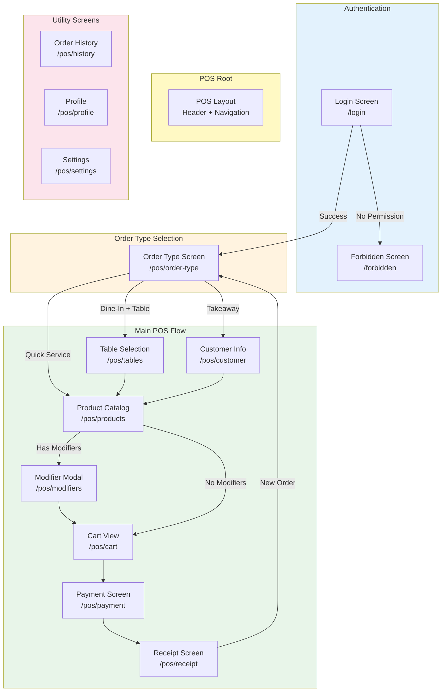
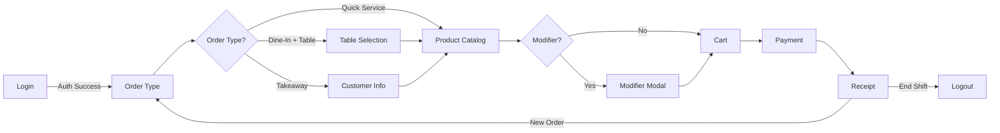
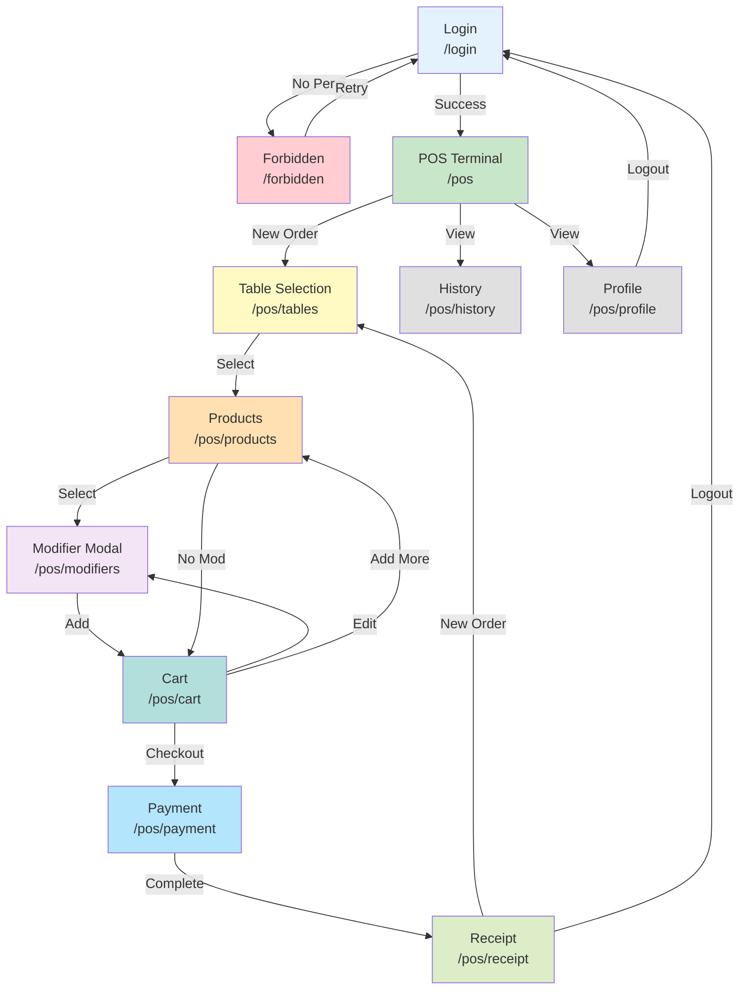

# POS Screen Flow Documentation

> **Document Version**: 1.1.0
> **Last Updated**: 2026-08-06
> **Reference**: POS_BUSINESS_FLOW.md

---

## Table of Contents

1. [Screen Overview](#screen-overview)
2. [Screen Hierarchy](#screen-hierarchy)
3. [Navigation Flow](#navigation-flow)
4. [Screen Specifications](#screen-specifications)
5. [Screen Relationships](#screen-relationships)

---

## Screen Overview

| Screen | Route | Purpose | Priority |
|--------|-------|---------|----------|
| Login | `/login` | Authenticate cashier | Required |
| POS Terminal | `/pos` | Main POS interface | Required |
| Order Type Selection | `/pos/order-type` | Select dine-in/takeaway | Required |
| Table Selection | `/pos/tables` | Select dining table | Conditional |
| Customer Info | `/pos/customer` | Enter takeaway customer | Conditional |
| Product Catalog | `/pos/products` | Browse & select products | Required |
| Modifier Selection | `/pos/modifiers` | Select product options | Conditional |
| Cart | `/pos/cart` | Review & adjust order | Required |
| Payment | `/pos/payment` | Process payment | Required |
| Receipt | `/pos/receipt` | Display & print receipt | Required |
| Forbidden | `/forbidden` | Access denied page | Required |
| History | `/pos/history` | View past orders | Future |
| Profile | `/pos/profile` | Cashier profile | Future |

---

## Screen Hierarchy



---

## Navigation Flow

### Main Navigation



### Navigation Pattern

```typescript
// Navigation Structure
interface POSNavigation {
  primary: {
    label: string;
    icon: LucideIcon;
    route: string;
  }[];
  secondary: {
    label: string;
    icon: LucideIcon;
    route: string;
  }[];
}

// POS Layout Navigation
const navigation: POSNavigation = {
  primary: [
    { label: 'POS', icon: ShoppingCart, route: '/pos' },
    { label: 'History', icon: History, route: '/pos/history' },
  ],
  secondary: [
    { label: 'Profile', icon: User, route: '/pos/profile' },
    { label: 'Settings', icon: Settings, route: '/pos/settings' },
  ]
};
```

---

## Screen Specifications

### 1. Login Screen

#### Route
```
/login
```

#### Purpose
Authenticate cashier user and validate POS access permission.

#### Layout
```
┌─────────────────────────────────────────────────────────┐
│                    GRADIENT BACKGROUND                    │
│                                                         │
│  ┌──────────────────────┐                               │
│  │                      │                               │
│  │       LOGO           │                               │
│  │    POS Cashier       │                               │
│  │                      │                               │
│  └──────────────────────┘                               │
│                                                         │
└─────────────────────────────────────────────────────────┘
         │
         ▼
┌─────────────────────────────────────────────────────────┐
│                    LOGIN FORM                            │
│                                                         │
│  ┌─────────────────────────────────────────────────┐    │
│  │  Email Address                                  │    │
│  │  ┌───────────────────────────────────────────┐  │    │
│  │  │ cashier@nexus.com                         │  │    │
│  │  └───────────────────────────────────────────┘  │    │
│  └─────────────────────────────────────────────────┘    │
│                                                         │
│  ┌─────────────────────────────────────────────────┐    │
│  │  Password                                        │    │
│  │  ┌───────────────────────────────────────────┐  │    │
│  │  │ ••••••••                                   │  │    │
│  │  └───────────────────────────────────────────┘  │    │
│  └─────────────────────────────────────────────────┘    │
│                                                         │
│  [     Sign in to POS      ]                            │
│                                                         │
└─────────────────────────────────────────────────────────┘
```

#### Components
- [x] Logo
- [x] Email Input (validated)
- [x] Password Input (with show/hide toggle)
- [x] Submit Button (with loading state)
- [x] Error Message Display
- [x] Remember Me Checkbox

#### Business Rules
| Rule | Description |
|------|-------------|
| BR-001 | Form validation: email required, password min 6 chars |
| BR-002 | Submit sends `{ app: 'pos' }` parameter |
| BR-003 | On 403: Show "Access Denied" message |
| BR-004 | On 401: Show "Invalid Credentials" message |

#### API Integration
```typescript
// Endpoint
POST /auth/login

// Request
{ email, password, app: 'pos' }

// Success Response
{ accessToken, user: { id, name, email, role } }

// Error Responses
401: Invalid credentials
403: You do not have permission to access POS Cashier
```

---

### 2. Forbidden Screen

#### Route
```
/forbidden
```

#### Purpose
Display when user lacks required POS permissions.

#### Layout
```
┌─────────────────────────────────────────────────────────┐
│                                                         │
│                    ┌─────────┐                          │
│                    │  🔒     │                          │
│                    └─────────┘                          │
│                                                         │
│                  Access Denied                          │
│                                                         │
│   You do not have permission to access the POS Cashier  │
│   application. Only users with the cashier role can    │
│   access this area.                                    │
│                                                         │
│  ┌─────────────────────────────────────────────────┐    │
│  │  ⚠️ Permission Error                            │    │
│  │  Your account does not have the required        │    │
│  │  permissions. Please contact your administrator. │    │
│  └─────────────────────────────────────────────────┘    │
│                                                         │
│  [         Back to Login        ]                       │
│                                                         │
└─────────────────────────────────────────────────────────┘
```

#### Components
- [x] Shield Icon (red)
- [x] Error Title
- [x] Error Description
- [x] Error Details Box
- [x] Back to Login Button
- [x] Logout Action

---

### 3. POS Terminal (Main Screen)

#### Route
```
/pos
```

#### Purpose
Main hub for POS operations. Shows quick actions and current status.

#### Layout
```
┌─────────────────────────────────────────────────────────┐
│ HEADER                                                  │
│ [Logo] POS Cashier        User: John  [Role] [Logout]  │
├─────────────────────────────────────────────────────────┤
│                                                         │
│  Welcome to POS Terminal                               │
│                                                         │
│  ┌─────────────────┐ ┌─────────────────┐ ┌────────────┐  │
│  │   🛒            │ │   📋            │ │   ⚙️      │  │
│  │   New Order     │ │   Orders        │ │  Settings  │  │
│  │   Start here    │ │   View active   │ │  Configure │  │
│  └─────────────────┘ └─────────────────┘ └────────────┘  │
│                                                         │
│  ┌─────────────────────────────────────────────────┐    │
│  │  POS Module Coming Soon                          │    │
│  │  Full POS features will be available soon.       │    │
│  └─────────────────────────────────────────────────┘    │
│                                                         │
├─────────────────────────────────────────────────────────┤
│ FOOTER                                                  │
│ POS Cashier System v1.0       Logged in as: john@...   │
└─────────────────────────────────────────────────────────┘
```

#### Components
- [x] Header with Logo
- [x] User Info Display
- [x] Role Badge
- [x] Logout Button
- [x] Quick Action Cards
- [x] Welcome Message
- [x] Footer

---

### 4. Order Type Selection Screen

#### Route
```
/pos/order-type
```

#### Purpose
Select the type of order: Dine-In (with table or quick service) or Takeaway.

#### Layout
```
┌─────────────────────────────────────────────────────────┐
│ HEADER                                                  │
│ [←Back] New Order                       [Cart: 0]      │
├─────────────────────────────────────────────────────────┤
│                                                         │
│  Select Order Type                                      │
│                                                         │
│  ┌─────────────────────────────────────────────────┐   │
│  │                                                   │   │
│  │     🍽️  DINE-IN                               │   │
│  │     Customer dining at restaurant                │   │
│  │                                                   │   │
│  │  ┌─────────────────────────────────────────┐   │   │
│  │  │  🍽️ With Table                         │   │   │
│  │  │  Select a table for dine-in              │   │   │
│  │  └─────────────────────────────────────────┘   │   │
│  │                                                   │   │
│  │  ┌─────────────────────────────────────────┐   │   │
│  │  │  ⚡ Quick Service                        │   │   │
│  │  │  No table required                       │   │   │
│  │  └─────────────────────────────────────────┘   │   │
│  │                                                   │   │
│  └─────────────────────────────────────────────────┘   │
│                                                         │
│  ┌─────────────────────────────────────────────────┐   │
│  │                                                   │   │
│  │     📦  TAKEAWAY                               │   │
│  │     Customer will take food to go              │   │
│  │                                                   │   │
│  │  ┌─────────────────────────────────────────┐   │   │
│  │  │  📋 Enter Customer Name                  │   │   │
│  │  └─────────────────────────────────────────┘   │   │
│  │                                                   │   │
│  └─────────────────────────────────────────────────┘   │
│                                                         │
└─────────────────────────────────────────────────────────┘
```

#### Order Type Options

| Type | Icon | Description | Table Required | Customer Name Required |
|------|------|-------------|----------------|----------------------|
| Dine-In (With Table) | 🍽️ | Customer sits at table | ✅ Yes | Optional |
| Dine-In (Quick Service) | ⚡ | No table (café style) | ❌ No | Optional |
| Takeaway | 📦 | Food to go | ❌ No | ✅ Yes |

#### Components
- [x] Back Button
- [x] Cart Badge
- [x] Order Type Card (Dine-In)
  - [x] Dine-In Option Card (With Table)
  - [x] Dine-In Option Card (Quick Service)
- [x] Order Type Card (Takeaway)
- [x] Customer Name Input (for Takeaway)
- [x] Continue Button

#### Business Rules
| Rule | Description |
|------|-------------|
| OT-001 | Dine-In with Table → Navigate to Table Selection |
| OT-002 | Quick Service → Navigate directly to Product Catalog |
| OT-003 | Takeaway → Show Customer Name input first |
| OT-004 | Takeaway Customer Name → Min 2 characters required |

---

### 5. Table Selection Screen

#### Route
```
/pos/tables
```

#### Purpose
Allow selection of dining table for the order.

#### Layout
```
┌─────────────────────────────────────────────────────────┐
│ HEADER                                                  │
│ [←Back] Table Selection                    [Cart: 3]   │
├─────────────────────────────────────────────────────────┤
│                                                         │
│  Select Table                                           │
│                                                         │
│  ┌──────────────────┐  ┌──────────────────┐           │
│  │  INDOOR          │  │  OUTDOOR         │           │
│  │  ┌────┐ ┌────┐   │  │  ┌────┐ ┌────┐   │           │
│  │  │ T01│ │ T02│   │  │  │ T05│ │ T06│   │           │
│  │  │ 4🪑 │ │ 4🪑 │   │  │  │ 6🪑 │ │ 6🪑 │   │           │
│  │  │ 🟢  │ │ 🔴  │   │  │  │ 🟢  │ │ 🔴  │   │           │
│  │  └────┘ └────┘   │  │  └────┘ └────┘   │           │
│  │  ┌────┐ ┌────┐   │  │                  │           │
│  │  │ T03│ │ T04│   │  │                  │           │
│  │  │ 2🪑 │ │ 2🪑 │   │  │                  │           │
│  │  │ 🟢  │ │ 🟠  │   │  │                  │           │
│  │  └────┘ └────┘   │  │                  │           │
│  └──────────────────┘  └──────────────────┘           │
│                                                         │
│  Legend:  🟢Available  🔴Occupied  🟠Reserved         │
│                                                         │
├─────────────────────────────────────────────────────────┤
│ FOOTER                                                  │
│ Walk-in Customer selected (default)                      │
└─────────────────────────────────────────────────────────┘
```

#### Table Card States
| Status | Color | Selectable |
|--------|-------|------------|
| Available | Green | ✅ Yes |
| Occupied | Red | ❌ No |
| Reserved | Orange | ❌ No |
| Maintenance | Gray | ❌ No |

#### Components
- [x] Back Button
- [x] Area Tabs (Indoor, Outdoor, VIP)
- [x] Table Grid
- [x] Table Card with:
  - [x] Table Number
  - [x] Table Name
  - [x] Capacity
  - [x] Status Badge
  - [x] Selectable State
- [x] Legend
- [x] Customer Info Display
- [x] Cart Badge

#### API Integration
```typescript
// Get tables
GET /dining-tables/active

// Get areas
GET /dining-tables/areas

// Response
{
  "data": [
    { "area_name": "Indoor" },
    { "area_name": "Outdoor" }
  ]
}
```

---

### 5. Product Catalog Screen

#### Route
```
/pos/products
```

#### Purpose
Display products organized by category for selection.

#### Layout
```
┌─────────────────────────────────────────────────────────┐
│ HEADER                                                  │
│ [←Back] Table T01  [Walk-in ▾]         [Cart: 4] $120K│
├───────────────┬─────────────────────────────────────────┤
│  CATEGORIES   │  PRODUCTS                               │
│               │                                         │
│ ┌───────────┐ │  ┌─────────┐ ┌─────────┐ ┌─────────┐  │
│ │ 🍚 Rice   │ │  │ [Img]   │ │ [Img]   │ │ [Img]   │  │
│ ├───────────┤ │  │ Nasi    │ │ Nasi    │ │ Nasi    │  │
│ │ 🍜 Noodle│ │  │ Goreng  │ │ Uduk    │ │ Mandi   │  │
│ ├───────────┤ │  │ $25K    │ │ $22K    │ │ $28K    │  │
│ │ 🥘 Side  │ │  └─────────┘ └─────────┘ └─────────┘  │
│ ├───────────┤ │  ┌─────────┐ ┌─────────┐ ┌─────────┐  │
│ │ 🥤 Bevera │ │  │ [Img]   │ │ [Img]   │ │ [Img]   │  │
│ ├───────────┤ │  │ Ayam    │ │ Ayam    │ │ Ayam    │  │
│ │ 🍰 Desser │ │  │ Bakar   │ │ Geprek  │ │ Goreng  │  │
│ └───────────┘ │  │ $30K    │ │ $28K    │ │ $27K    │  │
│               │  └─────────┘ └─────────┘ └─────────┘  │
│               │                                         │
├───────────────┴─────────────────────────────────────────┤
│ [View Cart]                                            │
└─────────────────────────────────────────────────────────┘
```

#### Product Card States
| State | Visual | Action |
|-------|--------|--------|
| Available | Normal | Tap to add |
| Sold Out | Grayed + "Sold Out" badge | Disabled |
| Popular | "Popular" badge | Highlighted |
| New | "New" badge | Highlighted |
| Has Modifier | "+" indicator | Opens modifier modal |

#### Components
- [x] Back Button (with table info)
- [x] Customer Dropdown
- [x] Cart Badge + Total
- [x] Category Sidebar
- [x] Category Item (icon + name)
- [x] Active Category Highlight
- [x] Product Grid
- [x] Product Card:
  - [x] Product Image
  - [x] Product Name
  - [x] Price
  - [x] Status Badge
  - [x] Modifier Indicator
- [x] View Cart Button

#### API Integration
```typescript
// Get categories
GET /categories/active

// Get products
GET /products/active?category_id={id}
```

---

### 6. Modifier Selection Modal

#### Route
```
/pos/modifiers (Modal)
```

#### Purpose
Allow selection of product modifiers (size, toppings, extras).

#### Layout
```
┌─────────────────────────────────────────────────────────┐
│                                                         │
│  ┌─────────────────────────────────────────────────┐    │
│  │  Nasi Goreng                              [X]    │    │
│  ├─────────────────────────────────────────────────┤    │
│  │                                                   │    │
│  │  Level Pedas (Required)                          │    │
│  │  ┌─────────────────┐ ┌─────────────────┐          │    │
│  │  │ ○ Normal       │ │ ● Pedas        │          │    │
│  │  │   +Rp 0        │ │   +Rp 0        │          │    │
│  │  └─────────────────┘ └─────────────────┘          │    │
│  │  ┌─────────────────┐                             │    │
│  │  │ ○ Sangat Pedas │                             │    │
│  │  │   +Rp 2,000    │                             │    │
│  │  └─────────────────┘                             │    │
│  │                                                   │    │
│  │  Level Gula (Optional)                           │    │
│  │  ┌─────────────────┐ ┌─────────────────┐          │    │
│  │  │ ☑ Gula Merah   │ │ ☐ Gula Pasir   │          │    │
│  │  │   +Rp 1,000    │ │   +Rp 0        │          │    │
│  │  └─────────────────┘ └─────────────────┘          │    │
│  │                                                   │    │
│  │  Special Request                                  │    │
│  │  ┌───────────────────────────────────────────┐   │    │
│  │  │                                           │   │    │
│  │  └───────────────────────────────────────────┘   │    │
│  │                                                   │    │
│  │  Quantity                                         │    │
│  │  [-] [ 1 ] [+]                                   │    │
│  │                                                   │    │
│  ├─────────────────────────────────────────────────┤    │
│  │  Item Total: Rp 27,000        [Add to Cart]     │    │
│  └─────────────────────────────────────────────────┘    │
│                                                         │
└─────────────────────────────────────────────────────────┘
```

#### Modifier Types
| Type | UI | Selection |
|------|-----|-----------|
| Single (required) | Radio buttons | Exactly 1 |
| Single (optional) | Radio buttons | 0 or 1 |
| Multiple | Checkboxes | 0 to max |

#### Components
- [x] Modal Header (Product Name)
- [x] Close Button
- [x] Modifier Group List
- [x] Modifier Option (Radio/Checkbox):
  - [x] Selection indicator
  - [x] Option name
  - [x] Additional price
- [x] Special Request Textarea
- [x] Quantity Stepper
- [x] Item Total Display
- [x] Add to Cart Button
- [x] Validation Messages

#### Business Rules
| Rule | Description |
|------|-------------|
| MR-002 | Required modifier: must select before add |
| MR-003 | Multiple selection: max enforced |
| MR-001 | Additional price added to item total |

---

### 7. Cart Screen

#### Route
```
/pos/cart
```

#### Purpose
Review order items, apply adjustments (tax, discount), and proceed to payment.

#### Layout
```
┌─────────────────────────────────────────────────────────┐
│ HEADER                                                  │
│ [←Back] Your Order                    Table T01        │
├─────────────────────────────────────────────────────────┤
│                                                         │
│  ┌─────────────────────────────────────────────────┐   │
│  │ 🛒 Cart Items                                     │   │
│  ├─────────────────────────────────────────────────┤   │
│  │ Nasi Goreng (Pedas)                       [Edit] │   │
│  │ Qty: 2 × Rp 25,000                    Rp 50,000   │   │
│  ├─────────────────────────────────────────────────┤   │
│  │ Teh Manis (Less Ice)                      [Edit] │   │
│  │ Qty: 1 × Rp 6,000                      Rp 6,000   │   │
│  ├─────────────────────────────────────────────────┤   │
│  │ Ayam Bakar                                    │   │
│  │ Qty: 1 × Rp 35,000                    Rp 35,000  │   │
│  │                                               [X] │   │
│  └─────────────────────────────────────────────────┘   │
│                                                         │
│  ┌─────────────────────────────────────────────────┐   │
│  │ Adjustments                                      │   │
│  │                                                   │   │
│  │ Tax (11% PPN):                         Rp 10,010  │   │
│  │ Discount:                                        │   │
│  │ ┌─────────────────────────────────────────────┐  │   │
│  │ │ [Enter code or select ▼]                    │  │   │
│  │ └─────────────────────────────────────────────┘  │   │
│  └─────────────────────────────────────────────────┘   │
│                                                         │
│  ┌─────────────────────────────────────────────────┐   │
│  │                                                   │   │
│  │ Subtotal:                               Rp 91,000│   │
│  │ Tax (11%):                              Rp 10,010│   │
│  │ Discount:                                      Rp 0│   │
│  │ ────────────────────────────────────────────────│   │
│  │ TOTAL:                                  Rp 101,010│   │
│  │                                                   │   │
│  └─────────────────────────────────────────────────┘   │
│                                                         │
│  [         Proceed to Payment         ]                 │
│                                                         │
├─────────────────────────────────────────────────────────┤
│ [+ Add More Items]                                      │
└─────────────────────────────────────────────────────────┘
```

#### Cart Item Actions
| Action | Icon | Description |
|--------|------|-------------|
| Edit | Pencil | Open modifier modal for item |
| Remove | X | Delete item from cart |
| Quantity | +/- | Adjust quantity |

#### Components
- [x] Back Button (with table info)
- [x] Cart Item List
- [x] Cart Item Row:
  - [x] Product name
  - [x] Modifiers (if any)
  - [x] Quantity stepper
  - [x] Unit price
  - [x] Line total
  - [x] Edit button
  - [x] Remove button
- [x] Tax Display (auto-calculated)
- [x] Discount Section:
  - [x] Code input
  - [x] Discount dropdown
  - [x] Applied discount display
- [x] Summary Box:
  - [x] Subtotal
  - [x] Tax amount
  - [x] Discount amount
  - [x] **TOTAL**
- [x] Proceed to Payment Button
- [x] Add More Items Button

---

### 8. Payment Screen

#### Route
```
/pos/payment
```

#### Purpose
Select payment method and process payment.

#### Layout
```
┌─────────────────────────────────────────────────────────┐
│ HEADER                                                  │
│ Payment                                    Table T01    │
├─────────────────────────────────────────────────────────┤
│                                                         │
│  Total Due: Rp 101,010                                 │
│                                                         │
│  Select Payment Method                                  │
│  ┌───────────────┐ ┌───────────────┐ ┌───────────────┐ │
│  │    💵         │ │    💳         │ │    📱         │ │
│  │    Cash       │ │    Debit      │ │    QRIS       │ │
│  └───────────────┘ └───────────────┘ └───────────────┘ │
│  ┌───────────────┐ ┌───────────────┐                   │
│  │    💳         │ │    📱         │                   │
│  │   Credit      │ │   E-Wallet   │                   │
│  └───────────────┘ └───────────────┘                   │
│                                                         │
│  ┌─────────────────────────────────────────────────┐   │
│  │  CASH PAYMENT                                    │   │
│  │                                                   │   │
│  │  Amount Tendered:                                │   │
│  │  ┌───────────────────────────────────────────┐   │   │
│  │  │ Rp 150,000                                │   │   │
│  │  └───────────────────────────────────────────┘   │   │
│  │                                                   │   │
│  │  Quick Amount:                                   │   │
│  │  [Rp 50K] [Rp 100K] [Rp 150K] [Exact]          │   │
│  │                                                   │   │
│  │  Change: Rp 48,990                              │   │
│  │                                                   │   │
│  └─────────────────────────────────────────────────┘   │
│                                                         │
│  [          Complete Payment         ]                  │
│                                                         │
└─────────────────────────────────────────────────────────┘
```

#### Payment Methods
| Method | Type | Requires Reference |
|--------|------|-------------------|
| Cash | CASH | No |
| Debit | CARD | Yes |
| Credit | CARD | Yes |
| QRIS | QRIS | Yes |
| E-Wallet | EWALLET | Yes |

#### Components
- [x] Total Amount Display
- [x] Payment Method Grid
- [x] Payment Method Card:
  - [x] Icon
  - [x] Name
  - [x] Selected state
- [x] Cash Panel:
  - [x] Amount input
  - [x] Quick amount buttons
  - [x] Change calculation
- [x] Card Panel:
  - [x] Reference number input
- [x] QRIS Panel:
  - [x] QR Code display
  - [x] Scanner ready indicator
- [x] Complete Payment Button
- [x] Cancel Button

#### Business Rules
| Rule | Description |
|------|-------------|
| PY-002 | Cash: Amount >= Total |
| PY-003 | Card/QRIS: Reference number required |
| PY-004 | Multiple payments allowed |

---

### 9. Receipt Screen

#### Route
```
/pos/receipt
```

#### Purpose
Display transaction receipt and complete order.

#### Layout
```
┌─────────────────────────────────────────────────────────┐
│                                                         │
│                    ┌───────────┐                         │
│                    │    ✓      │                         │
│                    └───────────┘                         │
│                                                         │
│                  Payment Successful!                     │
│                                                         │
│  ┌─────────────────────────────────────────────────┐    │
│  │ Receipt #: 20260806001                         │    │
│  │ Date    : 06/08/2026 14:30:00                  │    │
│  │ Table   : T01 - Indoor                         │    │
│  │ Cashier : John Doe                             │    │
│  ├─────────────────────────────────────────────────┤    │
│  │ ITEM                QTY         PRICE          │    │
│  ├─────────────────────────────────────────────────┤    │
│  │ Nasi Goreng           2       Rp 50,000       │    │
│  │   Level: Pedas                                 │    │
│  │ Teh Manis             1       Rp 6,000        │    │
│  │   Less Ice                                    │    │
│  │ Ayam Bakar            1       Rp 35,000       │    │
│  ├─────────────────────────────────────────────────┤    │
│  │ Subtotal                         Rp 91,000     │    │
│  │ Tax (11%)                       Rp 10,010      │    │
│  │ Discount                        Rp 0           │    │
│  ├─────────────────────────────────────────────────┤    │
│  │ TOTAL                           Rp 101,010     │    │
│  ├─────────────────────────────────────────────────┤    │
│  │ Payment                                    Cash  │    │
│  │ Amount Tendered                    Rp 150,000   │    │
│  │ Change                              Rp 48,990   │    │
│  └─────────────────────────────────────────────────┘    │
│                                                         │
│  [   Print Receipt   ]  [   Send Receipt   ]            │
│                                                         │
│  [       New Order        ]  [     Logout       ]      │
│                                                         │
└─────────────────────────────────────────────────────────┘
```

#### Components
- [x] Success Icon (animated checkmark)
- [x] Success Message
- [x] Receipt Details:
  - [x] Receipt number
  - [x] Date/time
  - [x] Table info
  - [x] Cashier name
  - [x] Item list with modifiers
  - [x] Subtotal
  - [x] Tax
  - [x] Discount
  - [x] Total
  - [x] Payment method
  - [x] Amount tendered
  - [x] Change
- [x] Print Button
- [x] Send Receipt Button
- [x] New Order Button
- [x] Logout Button

---

### 10. Order History Screen (Future)

#### Route
```
/pos/history
```

#### Purpose
View past orders for the current shift.

#### Layout
```
┌─────────────────────────────────────────────────────────┐
│ HEADER                                                  │
│ [←Back] Order History                    [Filter ▾]    │
├─────────────────────────────────────────────────────────┤
│                                                         │
│  Today - August 6, 2026                                │
│                                                         │
│  ┌─────────────────────────────────────────────────┐   │
│  │ #20260806001                    Rp 101,010      │   │
│  │ T01 - Indoor        14:30    Cash              │   │
│  │ 3 items                              [View]     │   │
│  └─────────────────────────────────────────────────┘   │
│  ┌─────────────────────────────────────────────────┐   │
│  │ #20260806002                     Rp 55,000      │   │
│  │ T03 - Outdoor       13:15    QRIS              │   │
│  │ 2 items                              [View]     │   │
│  └─────────────────────────────────────────────────┘   │
│  ┌─────────────────────────────────────────────────┐   │
│  │ #20260806003                     Rp 78,500      │   │
│  │ T02 - Indoor        12:00    Debit             │   │
│  │ 4 items                              [View]     │   │
│  └─────────────────────────────────────────────────┘   │
│                                                         │
│  Summary: 3 orders    Total: Rp 234,510                │
│                                                         │
└─────────────────────────────────────────────────────────┘
```

---

### 11. Profile Screen (Future)

#### Route
```
/pos/profile
```

#### Purpose
Display cashier profile and logout option.

#### Layout
```
┌─────────────────────────────────────────────────────────┐
│ HEADER                                                  │
│ Profile                                    [Settings]   │
├─────────────────────────────────────────────────────────┤
│                                                         │
│               ┌─────────────────┐                       │
│               │                 │                       │
│               │      👤         │                       │
│               │                 │                       │
│               └─────────────────┘                       │
│                                                         │
│               John Doe                                  │
│               Cashier                                   │
│                                                         │
│  ┌─────────────────────────────────────────────────┐   │
│  │  📧  john.doe@nexus.com                         │   │
│  ├─────────────────────────────────────────────────┤   │
│  │  📱  +62 812 3456 7890                          │   │
│  ├─────────────────────────────────────────────────┤   │
│  │  🏪  Main Outlet                                 │   │
│  ├─────────────────────────────────────────────────┤   │
│  │  📅  Shift: Morning (06:00 - 14:00)             │   │
│  └─────────────────────────────────────────────────┘   │
│                                                         │
│  [              Logout               ]                  │
│                                                         │
└─────────────────────────────────────────────────────────┘
```

---

## Screen Relationships

### Flow Diagram



### Component Dependencies

| Screen | Parent | Children |
|--------|--------|----------|
| Login | - | POSTerminal, Forbidden |
| Forbidden | Login | Login |
| POSTerminal | Login | Tables, History, Profile |
| Tables | POSTerminal | Products |
| Products | Tables | Modifier, Cart |
| Modifier | Products, Cart | Cart |
| Cart | Products, Modifier | Payment |
| Payment | Cart | Receipt |
| Receipt | Payment | Tables, Login |
| History | POSTerminal | - |
| Profile | POSTerminal | Login |

---

## Appendix

### Related Documents

1. [CLAUDE.md](../CLAUDE.md)
2. [POS_BUSINESS_FLOW.md](./POS_BUSINESS_FLOW.md)
3. [POS_API_FLOW.md](./POS_API_FLOW.md)
4. [POS_BLUEPRINT.md](./POS_BLUEPRINT.md)

### Revision History

| Version | Date | Author | Changes |
|---------|------|--------|---------|
| 1.0.0 | 2026-08-06 | System | Initial document |
